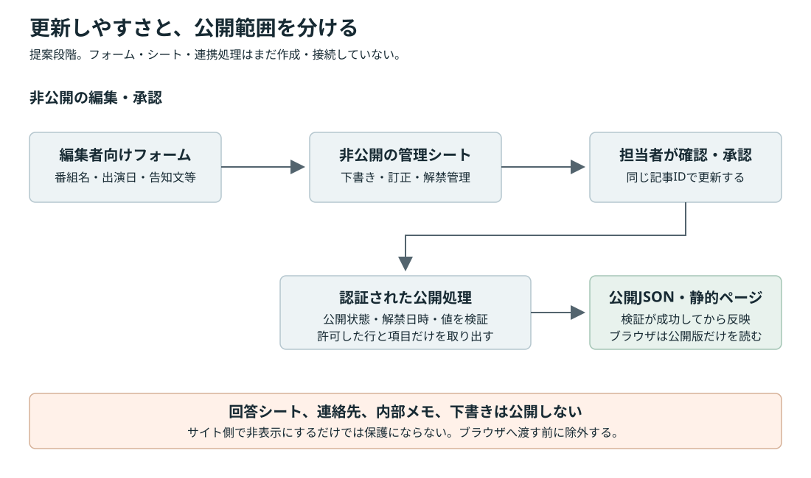

# メディア出演情報の更新方法

作成日：2026年10月28日／状態：運用方式の提案・外部サービスは未設定

関連資料：[要件定義書](./requirements-definition.md)／[ベータの仕様](./beta-ui.md)

## 1. 推奨する始め方

**テキストと日時が中心で、編集者が少人数なら、Googleフォームと非公開のGoogleスプレッドシートは適した選択肢です。**

ただし、フォームに入力するとサイトが自動更新される仕組みが標準で付いているわけではありません。入力・管理と、公開サイトへの反映をつなぐ処理が必要です。フォームの回答シートをそのまま一般公開する方法は推奨しません。

初期案は、フォームで下書きを登録し、スプレッドシートで確認・修正し、承認した項目だけを公開データに出す構成です。画像付きの長文記事や訂正が多くなる場合は、microCMSを優先して検討します。

現在のベータはローカルの[content.js](../content.js)にあるサンプルを表示しており、Googleアカウント、フォーム、シート、CMSとは未接続です。実際の運用で編集者にJavaScriptを書いてもらう前提ではありません。

ニュースとレギュラーメディアは別に管理します。出演予定の独立欄は作らず、「告知などはこちら」からマネージャー更新のInstagramへ案内する仕様です。現ベータではSNSをプロフィール欄に統合する案を表示しており、実アカウントURLは未設定です。

## 2. Googleフォーム＋スプレッドシート

### 編集者がすること

1. スマートフォンやPCから、編集者向けフォームを開きます。
2. 番組名、告知文、出演日、時刻、掲載先等を入力します。
3. 管理担当者がシートで内容と解禁時刻を確認します。
4. 確認した行を公開対象にします。
5. 公開反映の結果と、実際のサイト表示を確認します。

フォームは新規登録に向き、シートは一覧確認・訂正・掲載終了に向きます。同じ出演情報を修正するたびにフォームから新規送信すると、重複記事になりがちです。訂正は同じ記事IDの行を更新するか、管理者向けの編集手順を用意します。

### 入力項目の案

| 編集画面の項目 | 公開データでの役割 | 注意点 |
|---|---|---|
| 記事ID | 同じ記事を特定するキー | 自動発行し、訂正でも変更しない |
| タイトル | ニュースの見出し | 番組・イベントを判別できる文言 |
| カテゴリ | メディア、イベント、お知らせ等 | 選択式にして表記揺れを防ぐ |
| 告知文・本文 | 一覧の説明と詳細 | HTMLを直接入力させず、文字として扱う |
| 媒体・番組名 | TV、ラジオ、配信等の補足 | 空欄を許すかを運用に合わせる |
| 出演日・開始時刻 | ニュース詳細に必要な日時の案内 | 告知の公開日時とは別。日本時間を基準にする。独立した出演予定一覧は作らない |
| 公開日時 | 情報解禁・予約公開 | 未到達の日時は公開データへ出さない |
| 掲載状態 | 下書き、公開、掲載終了 | 編集権限のある人だけが変更する |
| 掲載先URL | 番組・記事等へのリンク | HTTPS等の許可するURL形式を検証 |
| 画像・権利確認 | 任意のサムネイル | フォームの添付ファイルやDriveの共有URLを、そのままWeb画像にしない |

編集者のメールアドレス、回答編集用URL、連絡先、内部メモ、解禁前の原稿、承認コメントは非公開のままにします。

### レギュラーメディア用の入力

ニュースと別のシート・入力区分を用意します。フォームを分けるか、最初に掲載種別を選ぶ構成を検討します。

| 項目 | 内容 |
|---|---|
| 掲載ID・タイトル | 番組・媒体を特定するキーと名称。タイトルは読み上げ名に使用 |
| カテゴリ | 地上波・ネット・ラジオから選択。ニュースのカテゴリとは別 |
| 番組画像・代替テキスト | 必須。PNG・JPEG・WebPの番組バナーやロゴと、番組・媒体を判別できる代替テキストを用意。権利も確認 |
| 外部URL | 任意。画像から公式サイト等へ移動 |
| 公開状態・掲載順 | 承認済みの情報だけを指定順で表示 |

番組名・紹介文・放送枠は画像の下に表示しません。画像がない行は公開せず、設定エラーとして通知します。URLがない場合はリンクを生成せず、不正なURLを空欄扱いで公開しないように検証します。画像を後から変更した場合も、同じ掲載IDで更新します。

### 公開への反映方法

最も扱いやすい案は、認証された公開処理がシートを読み、公開可能な行と許可した列だけを取り出して、サイトと同じ配信元へJSONまたは静的ページを出す方法です。

- ブラウザにGoogleの認証情報や秘密のAPIキーを置きません。
- 公開処理で、状態、公開日時、必須値、ID重複、日時、URLを検証します。
- 公開データは必要な項目だけから作ります。列を追加したら勝手に公開される処理にはしません。
- 既存の公開版をいったん削除せず、検証・生成が成功してから置き換えます。失敗を担当者へ知らせます。
- 訂正、公開取り消し、出演中止も同じIDで反映します。古い内容をキャッシュに残さない更新方法が必要です。
- 予約公開は公開時刻に再生成する処理が必要です。編集時だけの更新では、予約時刻になっても反映されません。

Apps Scriptは連携処理の候補です。フォーム送信や編集のトリガー、時間主導の処理を使えますが、認可、所有者、実行時間、割り当て上限の管理が必要です。時刻トリガーには実行のずれがあり、秒単位で正確な解禁を約束する用途には、そのまま適用しません。

Apps ScriptのWebアプリをブラウザから毎回直接読む方法は、アクセス増による上限、CORS・リダイレクト、障害時の表示、レスポンス速度の確認が必要です。初期案では、公開処理から静的な公開データへ反映する方法を優先します。公開先を決めた後に、最小限の連携方法を選びます。

### シートを「ウェブに公開」する場合の注意

個人情報や下書きのない、公開専用のデータに限る方法です。「リンクを知っている人が閲覧可能」と「ウェブに公開」は、どちらも秘密情報の保護手段ではありません。

フォームの回答シートや内部の管理シートをそのまま公開しません。公開専用の別ファイルを作り、列を限定する方法でも、公開・停止の確認と誤操作対策が必要です。公開までの反映時間も、選択する配信・キャッシュ・更新間隔によって変わります。

## 3. 他の方法との比較

| 方法 | 編集者の操作 | 得意なこと | 主な負担・注意点 |
|---|---|---|---|
| Googleフォーム＋Sheets＋公開処理 | フォーム入力と表での確認 | 日時中心の出演情報、少人数、慣れたGoogleの画面 | 承認・プレビュー・画像・公開反映を別途設計。表の列変更にも注意 |
| microCMS＋現在の独自UI | 日本語の管理画面で記事を編集 | 下書き、画像、本文、公開状態、訂正を継続管理 | フロント側のAPI連携とプレビューが必要。権限・費用は契約前に確認 |
| WordPress | 投稿の管理画面を使用 | 一般的なブログ記事、画像、カテゴリの管理 | サーバー、プラグイン、更新・バックアップ等の保守が必要 |

### 今回の選び方

- **出演日・番組名・短い告知が中心**：Googleフォーム＋Sheetsを第一候補にします。登録はフォーム、訂正・承認はシートという使い分けが分かりやすい構成です。
- **画像付きの記事や長文、訂正が頻繁**：microCMSを推奨します。今回のUIを保ちながら、編集用の画面を別に持てます。
- **WordPressに慣れた運営者がいて、保守も任せられる**：WordPressも候補です。未経験の少人数運営に、慣習だけを理由に追加する必要はありません。

microCMSの下書きプレビューは、管理画面で設定するだけで自動完成する機能ではありません。下書きを取得するフロント側のプレビュー実装が必要です。下書き取得権限のあるキーは公開しません。レビューと予約設定の組み合わせにはサービス固有の条件もあるため、採用時に確認します。

ここでは最新の月額金額や無料枠での収容件数を保証していません。利用人数、権限、画像容量、API回数、契約主体を決めてから、公式の現行プランを確認します。

## 4. LINEから更新する案

[feature idea.md](../feature%20idea.md)にある、LINEを使う案も検討できます。初期版では、管理用LINEグループ等にGoogleフォームのURLを固定する方法が最小です。LINEを開いてフォームへ進めるため、投稿用ボットを新設せずに済みます。

LINEのトーク文を自動で記事にする場合は、Webhook、署名の検証、投稿者の制限、入力の解釈、重複対策、下書き確認、訂正方法が必要です。会話の誤送信をそのまま公開する設計にはしません。まずフォームで項目を分け、必要性が確認できてからボット化する案を推奨します。

## 5. 公開前に確認すること

- 更新する人と承認する人。兼任でも、解禁・日時・権利の確認は残す。
- 修正、出演中止、削除を誰がどの画面から行うか。
- 公開までの許容時間と、解禁時刻の正確さ。
- 画像付きの長文記事が必要か、予定表が中心か。
- GoogleやCMSの契約・所有者を、制作担当者だけにしないこと。
- 連携が失敗した場合に、誰が気付き、どう復旧するか。
- 投稿0件、画像なし、予定の終了、時差、通信障害でも表示できること。

## 6. 公式資料

2026年10月28日確認。

- [Googleフォームの回答保存先](https://support.google.com/docs/answer/2917686?hl=en)
- [Googleドキュメント等のウェブ公開](https://support.google.com/docs/answer/183965?hl=en)
- [Apps ScriptのWebアプリ](https://developers.google.com/apps-script/guides/web)
- [Apps Scriptのインストール型トリガー](https://developers.google.com/apps-script/guides/triggers/installable)
- [Apps Scriptの割り当てと制限](https://developers.google.com/apps-script/guides/services/quotas)
- [microCMSの公開状態](https://document.microcms.io/manual/content-status)
- [microCMSの画面プレビュー](https://document.microcms.io/manual/screen-preview)
- [microCMSのレビュー](https://document.microcms.io/manual/review)
- [LINE Messaging APIのWebhook受信](https://developers.line.biz/en/docs/messaging-api/receiving-messages/)
