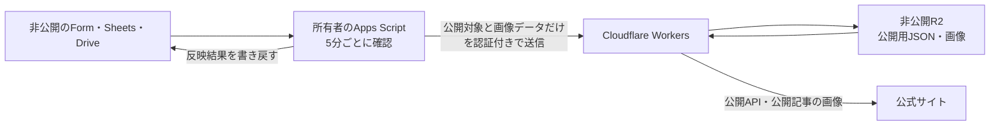

# Google Sheets・Formsによるニュース管理

更新日：2026年11月4日

## 実装と接続の状態

Sheets・Driveは非公開のまま使います。シート所有者が認可したApps Scriptが公開対象だけをCloudflare Workersへ送り、Workerが非公開R2へ保存してHPへ配信します。シートURL・Driveの元リンク・ファイルIDはGoogle側に留め、Googleの秘密鍵は発行しません。

テスト用Workerと非公開R2は準備済みです。実HTTPで、初回送信前のAPIが503、未認証の送信・状態取得が404、認証済みでも余分な項目を含むデータが400になることを確認しました。拒否の確認に公開データの登録は行っていません。

通常のソース設定と既存のGitHub Pagesデモは `newsSource.mode: "sample"` のままです。別URLのテストHPでは、依頼者が入力した実シートの架空ニュースをAPI経由で表示できることを確認しました。シートは日本時間に設定され、入力6行のうち公開対象4件を手動反映済みです。所有者のApps Scriptによる定期更新と実画像の取り込みは未確認です。



## 手入力したシートでの接続テスト

[テストHP](https://rkhp-news-test.rkhp-preview-d0f68d.workers.dev/#news)は、シートの一般公開や編集権限の追加をせず、既存の閲覧権限で取得したデータを表示しています。今回は制作端末から短時間の読み取り専用トークンを使い、検証済みの公開対象だけを認証付きでWorkerへ送りました。Googleの秘密鍵は発行していません。

| 確認項目 | 実サービスでの結果 |
|---|---|
| 入力と公開件数 | 入力6行から公開対象4件を取得し、API・HPで一致 |
| 入力順に依存しない表示 | 新しい記事、中間A、中間B、古い記事の順。中間2件は同日でID順 |
| 非公開対象 | 下書き・未来記事のIDと本文の確認用文字列は公開APIに含まれない |
| 表示操作 | すべて4件、メディア1件、イベント2件、お知らせ1件。展開した本文がAPIと一致 |
| 表示幅 | 390・1440 CSS pxで4件を表示し、横にはみ出さない |
| 元データの保護 | 実シートID、連携アカウント、元のGoogleリンクを公開データへ含めない |
| 配信範囲 | 公開用18ファイルだけを配信。資料・スクリプト・秘密設定・原本画像・内部状態の9パスは404 |

このテストは手動反映です。シートを編集しただけでは、まだ5分ごとの自動反映は行いません。画像、公開終了・削除の実運用、別アカウントへの切替は別途確認します。公開対象は一般閲覧できるため、未解禁情報や個人情報をテスト公開しないでください。

テストHPはAPI接続用に調整した生成物をテストWorkerへ一時配信しています。通常のビルドはサンプル設定を使い、通常のWorker設定はAPI専用です。このテストURLを再デプロイする際は、API接続設定と静的アセット設定を維持してください。既存のGitHub Pagesデモと本番DNSは変更していません。

## 入力する列

[テスト用CSV](./news-sheet-template.csv)を、非公開のテストシートへインポートできます。列の並びは自由です。

| 既定の列名 | 条件・操作 |
|---|---|
| 掲載日時 | 公開する記事で必須。日本時間の `2026/11/04` のような日付だけを入力。時刻は不要。列名は既存互換のため維持する |
| タイトル | 公開する記事で必須、200文字以内 |
| カテゴリ | 公開する記事で必須。「メディア」「イベント」「お知らせ」から選ぶ |
| 本文 | 公開する記事で必須、20,000文字以内。改行で段落を分ける。HTMLは不要 |
| 出演・開催日時 | 任意。掲載日時や表示順とは別に扱う |
| 外部リンク | 任意。認証情報のないHTTPSのURL。管理シートやDriveのURLは指定しない |
| 画像URL | 任意。Driveのファイル共有リンク、またはFormsが保存したファイルURLを1件指定 |
| 画像の説明 | 画像がある場合に必須、300文字以内。画像の内容を説明する |
| 記事ID | 補助スクリプトが自動発行。変更・再利用・コピーをしない |
| 公開状態 | 空欄または「下書き」は非公開。「公開」で掲載対象、「公開終了」で掲載停止 |
| 最終反映日時・反映結果 | 補助スクリプトが送信結果を記録する。手入力しない |

HPは掲載日の新しい順に表示し、同日なら記事IDで順番を固定します。入力した順番、Formsのタイムスタンプ、本文を修正した日時では並び替えません。記事IDを保てば、行を移動しても同じ記事として扱います。

シートのタイムゾーンは `Asia/Tokyo` に設定します。掲載日は日付セルまたは `2026/11/04` 形式の文字列に対応し、取り込み時に日本時間の0時へ統一します。既存の時刻付きデータも日本時間の日付だけを採用し、時刻を表示順や公開待ちの判定に使いません。出演・開催日時の時刻は維持します。不明な日付形式や存在しない日付は公開しません。

## Google Formの回答シート

Google Formの回答先を使う場合は、既存の回答列を削除・上書きしません。質問名を列名として読み、必要な管理列を追加します。タイムスタンプ、メールアドレス、回答編集用URLなどの余分な列は公開データへ出しません。

現在のテスト用タブは「フォームの回答 1」です。「出演、開催日」と「画像」の列を読む場合は、Google側の `NEWS_WORKSHEET` をこのタブ名にし、`NEWS_COLUMNS` に `{"startsAt":"出演、開催日","image":"画像"}` を設定します。旧タブ名や既定の画像列名を前提に回答シートを作り直しません。

掲載日の質問は、既定の列名と揃えて「掲載日時」とし、質問形式は「日付」を選びます。「年を含める」を有効にし、時刻は追加しません。回答者はGoogle Form標準の日付コントロールで年月日を選択します。カレンダーの表示形式は端末・ブラウザに依存します。質問名を「掲載日」にする場合は `NEWS_COLUMNS` の `publishedAt` をその名前へ対応させます。

未来の掲載日は、その日が日本時間で始まるまで非公開です。時刻単位の解禁は掲載日では管理しないため、解禁時刻までは下書きにし、担当者が確認して公開状態へ変更します。

画像アップロードの質問は、任意・1ファイルに設定してください。初期版はJPEG・PNG・WebP、1画像10MiB以内です。複数画像やHEIC・SVG等はエラーとして案内し、勝手に先頭の画像だけを使いません。Formsのアップロードを使う編集者には、Google側で必要なログイン・権限が必要です。

Formsが作る画像保管フォルダーを連携対象とし、質問別の子フォルダーも参照できます。Google側の `NEWS_UPLOAD_FOLDER_ID` で指定したフォルダーの外にある画像は取り込みません。画像フォルダーをまだ用意していない段階では、この設定を省略してテキストだけを送信できます。フォルダー未設定で画像が入力された場合は反映を停止し、任意のDriveファイルへ取りに行きません。

これはニュース編集者用のフォームです。一般公開の問い合わせフォームや、その回答・個人情報と混ぜないでください。

## Google側の初期設定

制作担当者がCloudflareの受信口を準備した後、シート所有者が一度だけ導入・認可します。日常の更新にGoogle CloudやCloudflareの管理画面は不要です。

Googleへのログインと以下の設定は、通常のEdgeまたはChromeで行ってください。VS Code内などの組み込みブラウザや自動操作環境では、Googleがログインを拒否する場合があります。「JavaScriptが無効・非対応」と表示された場合も、まず通常のブラウザでシートを開き直します。詳細は[Googleの対応ブラウザ案内](https://support.google.com/accounts/answer/7675428?hl=ja)を参照してください。Google Cloud CLIの認証だけでは、シートやApps Scriptの編集認可にはなりません。

1. シートの一般的なアクセスを「制限付き」に保ち、管理するタブを開きます。既存のForm回答をテストデータで上書きしません。
2. 「拡張機能」のApps Scriptを開き、[補助スクリプト](../scripts/google-news-sheet.gs)の全体を登録して保存します。
3. Apps Scriptのプロジェクト設定でマニフェストの表示を有効にし、`appsscript.json` を[提供マニフェスト](../scripts/appsscript.json)の内容に置き換えて保存します。
4. 所有者アカウントで実行し、対象シートの編集、Driveの閲覧、外部通信、トリガー作成の権限を確認して許可します。シート操作は `@OnlyCurrentDoc` と `spreadsheets.currentonly` で対象ブックに限定します。Driveの認可自体は閲覧用スコープであり、フォルダーの制限はスクリプト内で検証します。
5. 空の `RKHP News Test` では `setupNewsTest()`、既存の記事やForm回答がある場合は `configureNewsPublisher()` を選んで実行します。前者は確認後に架空ニュース3件を公開対象で登録します。後者は架空データを追加しません。
6. 表示される入力画面で、案内されたAPIオリジン、連携元の識別子、公開用トークンを順に入力します。これらの関数は列の初期化、日本時間の設定、ID発行、初回送信、5分トリガーの登録を行います。

テスト端末では、リポジトリのルートで次を本人が実行すると、Windows資格情報ストアから公開用トークンをクリップボードへコピーできます。値は画面に出しません。チャット・スクリーンショット・共有資料へ貼らず、Apps Scriptの入力画面だけへ貼り付けてください。貼り付け後は別の文字をコピーし、クリップボード履歴・同期の設定も確認します。

```powershell
& ".\scripts\copy-news-test-token.ps1"
```

この補助コマンドは、CLIを準備したテスト端末専用です。実行ポリシーで拒否された場合は迂回せず、管理者へ確認してください。

設定関数は次のスクリプトプロパティを保存します。Formの質問名が既定と異なる場合は、初回送信前に `NEWS_COLUMNS` を設定してください。画像を使う場合は所有者が読める専用フォルダーも指定します。

| スクリプトプロパティ | 設定する内容 |
|---|---|
| `NEWS_MODE` | `push` |
| `NEWS_API_ORIGIN` | ニュースWorkerのHTTPSオリジン。末尾の `/` は付けない |
| `NEWS_SOURCE_NAMESPACE` | Workerの `NEWS_SOURCE.namespace` と同じ連携元の識別子。シートURLやIDではない |
| `NEWS_PUBLISH_TOKEN` | Workerと同じ公開用トークン。32〜200文字の英数字・`_`・`-` |
| `NEWS_WORKSHEET` | 管理対象の回答タブ名 |
| `NEWS_COLUMNS` | 任意。質問名が既定と異なる場合のJSON対応表 |
| `NEWS_UPLOAD_FOLDER_ID` | 画像を使う場合に必須。許可するDriveフォルダーのID。Google側だけに置く |

管理列は `記事ID`・`公開状態`・`最終反映日時`・`反映結果` の名前を維持します。空のタブでは入力列も作成し、既存の回答タブでは管理列だけを追加します。既定名のカテゴリ列には選択肢、日時列には表示形式を設定します。質問名を変更したForm側の選択肢はFormで設定してください。

手入力とフォーム送信の両方でIDを発行し、5分ごとに `publishNews()` を実行します。Forms経由の変更は編集トリガーだけでは拾えないため、フォーム送信トリガーも登録します。初回送信が失敗した場合は原因を修正し、`publishNews()` の成功後に `installNewsTriggers()` を実行してください。

Apps Scriptはトリガーを作成したアカウントで動きます。所有者が変わった場合は新しいシートで導入・認可します。組織ポリシーで認可が禁止される場合は管理者へ確認し、制限を迂回しません。推奨方式では、Google Cloudプロジェクトの作成、サービスアカウント、Googleの秘密鍵は不要です。

## Cloudflare側の設定

ニュースWorkerは、静的サイトとは別にデプロイします。[Worker設定](../workers/news/wrangler.jsonc)は `test` と `production` を分け、別Worker・別R2バケットを使用します。

R2の公開バケットや `r2.dev` は有効にしません。画像は公開記事に参照されているものだけをWorkerが返します。

| 設定 | 配置先・用途 |
|---|---|
| `NEWS_ENV` | サーバー設定。`test` または `production` |
| `PUBLIC_ORIGIN` | ニュースAPIのHTTPSオリジン。末尾の `/` は付けない |
| `SITE_ORIGIN` | 許可するサイトのHTTPSオリジン。GitHub Pagesならパスを含めずホスト部分だけ |
| `NEWS_SOURCE` | Worker Secret。`mode: "push"` と環境固有の `namespace` だけ |
| `NEWS_PUBLISH_TOKEN` | Worker Secret。公開データ・画像の受信を認証する32〜200文字のランダム値 |
| `STATUS_TOKEN` | Worker Secret。内部状態の読み取り専用。公開用とは別の32文字以上のランダム値 |
| `NEWS_BUCKET` | 環境ごとの非公開R2バインディング |

次は `NEWS_SOURCE` の形式例です。実際の値をこのファイルやGitHubへ書かないでください。

```json
{
  "mode": "push",
  "namespace": "replace-news-test-source"
}
```

`namespace` は10〜100文字の小文字英数字・`-` で作り、テストと本番で分けます。シートURL・Googleアカウント・画像フォルダーIDはWorkerへ登録しません。

列名の対応はGoogle側の `NEWS_COLUMNS` に設定します。既定名なら省略できます。

```json
{
  "title": "ニュースのタイトル",
  "body": "お知らせ本文",
  "image": "画像をアップロード"
}
```

| 対応キー | 既定の列名 |
|---|---|
| `publishedAt` / `title` | 掲載日時 / タイトル |
| `category` / `body` | カテゴリ / 本文 |
| `startsAt` / `url` | 出演・開催日時 / 外部リンク |
| `image` / `imageAlt` | 画像URL / 画像の説明 |

必須列の不足、対応先の重複、明示した列名が見つからない場合は反映を停止します。列の位置をコードへ固定していないため、質問順や列順の変更だけで取り込み先がずれることはありません。

Wranglerが使える環境では、リポジトリのルートから次を実行します。この変更ではnpm依存を追加していません。

```powershell
wrangler r2 bucket create rkhp-news-test
wrangler secret put NEWS_SOURCE --config ".\workers\news\wrangler.jsonc" --env test
wrangler secret put NEWS_PUBLISH_TOKEN --config ".\workers\news\wrangler.jsonc" --env test
wrangler secret put STATUS_TOKEN --config ".\workers\news\wrangler.jsonc" --env test
wrangler deploy --config ".\workers\news\wrangler.jsonc" --env test
```

実際のCloudflareアカウントを確認して実行します。準備済みのテスト環境でバケットを作り直す必要はありません。`PUBLIC_ORIGIN` と `SITE_ORIGIN` も対象環境に合わせます。推奨方式の定期実行はGoogle側が担当するため、WorkerのCronは空にします。

値はSecretの入力画面で設定します。トークンをチャット・コマンド引数・コミットへ貼らず、ローカルで使う場合も[例示ファイル](../workers/news/.dev.vars.example)と実値を区別してください。実値を入れた `.dev.vars` 系のファイルはGitと公開用ビルドから除外しています。

## サイトへの接続

テストAPIの最初の同期が成功したら、[content.js](../content.js)の `newsSource` だけを変更します。

```javascript
newsSource: {
  mode: "api",
  endpoint: "https://replace-news-test.example.com/api/news"
}
```

ここに設定するのは公開用APIのURLだけです。Sheet・DriveのURL、ファイルID、Googleの認証情報は指定しません。

APIモードで取得に失敗した場合、サンプル記事へ切り替えずエラーを表示します。最初の同期前はAPIが503を返します。同期に失敗して直前の正常版がある場合は、APIの `stale` とHPの案内で、更新を確認できていないことを伝えます。

## 別アカウント・別シートへの切替

1. 本番アカウントでForm・回答シート・画像フォルダーを用意します。確定した質問名を使い、異なる部分は列名対応に設定します。
2. `production` 用の別Worker・別R2・公開オリジン・Secretを準備します。`namespace` と公開用・状態取得用トークンはテストと分け、WorkerのCronは空にします。
3. 新しいシートに同じ補助スクリプトとマニフェストを導入し、新しい所有者が認可します。画像フォルダーの閲覧権限は、この所有者に必要です。
4. 必要な `NEWS_COLUMNS`・`NEWS_UPLOAD_FOLDER_ID` をGoogle側へ設定し、`configureNewsPublisher()` で本番のAPI・識別子・公開用トークンを登録します。`setupNewsTest()` は本番で使いません。
5. 本番APIで、並び順・画像・公開終了・余分な列の非公開を確認します。確認後にサイトの `endpoint` を本番APIへ変更します。
6. テストを終えたら、Google側の古いトリガー・共有を停止し、不要なトークンを失効させます。旧Google Cloudプロジェクトや閲覧用サービスアカウントの削除は、用途を確認して別途行います。

Worker側は環境・APIオリジン・識別子・公開用トークンに応じて保存先を分けます。同じWorkerで接続先を変える場合も、識別子と公開用トークンを更新し、新しいシートへ同じ値を設定してください。Google側の列名やフォルダーだけを変えてもWorkerの保存先は変わりません。

新しい接続設定での初回送信が失敗した場合は、以前のテスト記事を返さず503にします。古い保存データは非公開のまま残るため、不要になったテスト環境の削除は別途行います。

## 公開・削除・失敗時の挙動

自動更新を有効にした後は、Google側が5分ごとに送信し、公開データと画像のキャッシュは最大60秒です。5分周期の実行待ちに読み取り・画像取り込み時間が加わるため、通常6分前後を目標とします。Google側の実行遅延や画像量によって長くなる場合があり、厳密な上限ではありません。反映結果は同じ送信処理でシートへ記録します。

現在は手動反映のテスト段階で、自動更新はまだ有効になっていません。また、開いたままのHPは常時同期せず、ページを開き直すか再読み込みした際に取得します。

公開対象の必須値・画像を検証し、全体の生成が成功してから公開JSONを置き換えます。途中の失敗では直前の正常版を保持します。この場合は公開終了や削除も未反映になるため、表示されたエラーを修正して再同期してください。

記事を公開終了にするか行を削除すると、次の正常な同期で公開一覧から外れます。ほかの記事で使っていない画像は配信停止・削除し、共用画像は残します。Driveの元画像削除や閲覧権限の解除だけでは、公開を止める操作の代わりになりません。

公開JSONの書き込み結果が不明な場合に画像まで巻き戻すと、正常に公開された画像を誤削除するおそれがあります。そのため失敗時の未参照画像は非公開のR2内に残す場合があります。サイトからは取得できませんが、使用量を確認し、回収時は現在の公開JSONと参照を照合してください。

画像は原本の内容をコピーします。初期版は再圧縮・EXIF等の除去をしないため、位置情報などの不要なメタデータを除いた公開可能な素材を使用してください。保存済みのコピーや、閲覧者が開いたままの画面は回収できません。

## セキュリティと運用上の制限

シートのURLを隠すことだけに依存せず、Google側の共有を非公開に保ちます。Apps Scriptが下書き・公開終了・未来の記事本文と余分な列を送信対象から除外し、Workerも公開日時と許可フィールドを再検証します。画像は元リンクではなく実データだけを送ります。

公開用トークンはニュースを書き換えられる認証情報です。シート編集者は紐づくスクリプトや設定にもアクセスできるため、信頼できる担当者だけに編集権限を付けます。漏えい時はWorkerとGoogle側の両方で公開用トークンを更新してください。

エラー応答・通常のアプリログには固定のエラーコードと行番号だけを使い、シートID・元のDriveリンク・認証情報・Googleの応答本文を記録しません。Wranglerの呼び出しログは無効にしています。デバッグ時に別の場所へ実値を追加しないでください。

公開ニュースAPIと、公開済み記事の画像は一般閲覧用です。CORSや非推測的なURLを閲覧認証の代わりにはしません。下書きはAPIへ含めず、内部状態APIは別のBearerトークンで保護します。テストで「公開」にした内容もテストAPIから読めるため、未解禁情報をテスト公開しないでください。

初期版は1タブ1,000行のデータ、公開用JSONの送信2MiB以内、画像1枚10MiB以内を対象とします。Workerの公開処理は4分のロックとR2の条件付き書き込みで多重実行や古い公開版の上書きを防ぎます。Apps Scriptの実行時間・割り当て、WorkersのCPU時間、R2の使用量は運用開始時に確認します。

Apps Script自体が実行されない場合や失敗の報告まで届かない場合、APIの `stale` だけでは停止を検知できません。最終反映日時とGoogle側の実行履歴・失敗通知を定期的に確認してください。

### 旧取得方式について

サービスアカウントでWorkerからGoogle APIを読む `pull` 方式は、既存コードとの互換用に残しています。こちらは `NEWS_SOURCE` にシート・タブ・フォルダー・列名対応、`GOOGLE_SERVICE_ACCOUNT` にGoogleの認証JSONを設定し、Worker側の5分CronとGoogle側の状態取得用設定が必要です。推奨する `push` 方式とは混在させません。

今回のGoogle組織ポリシーはサービスアカウントの秘密鍵発行を禁止しています。この制限は変更せず、鍵なし方式を使います。作成済みのGoogle Cloudプロジェクトと閲覧用サービスアカウントは読み取り確認に使用しましたが、推奨方式の稼働には不要です。

## 確認方法

Node.js 22が使える環境では次のテストを実行します。

```powershell
node --test ".\tests\build-site.test.mjs" ".\tests\news-sync.test.mjs" ".\tests\google-news-sheet.test.mjs" ".\tests\browser-unit.test.mjs"
```

共通のニュース連携チェックは[ブラウザ版](../tests/news-sync.html)でも実行できます。Apps Scriptの専用テストはNodeで実行します。Google API、R2、送信処理は模擬環境で確認するため、実アカウントのファイルやメールを外部へ送信しません。

実シートでは、フォーム送信後のID発行、行の並び替え、列名の対応、画像アップロードと差し替え、公開終了、認証失敗、APIに内部情報が含まれないことを確認してください。模擬テストだけで実接続を完了扱いにはしません。

### 今回確認した範囲

ニュース連携では、期限切れの同期が新しい公開画像や状態を上書き・削除しないことと、書き込みの応答を失っても確定済み画像を残すことを確認しています。実コードを使ったAPI表示・更新失敗時の案内・0件・取得エラーの4ケースも、隔離したDOMと模擬APIで確認しています。既存のサンプル表示はPC・スマートフォン幅で横にはみ出さず、問い合わせの入力内容を保持することを確認しました。

日付のみの掲載指定を含むNodeのテスト68件が成功しました。共通ヘルパー64項目を実行する1ケース、ビルド3ケース、ニュース連携46ケース、Apps Script18ケースです。時差を含む日付の統一、同日内の時刻を使わない表示順、翌日の日本時間0時の公開判定、出演時刻の維持を確認しています。下書き・未来の本文・内部列の除外、画像フォルダー制限、初回設定時の既存回答保護も模擬環境で確認しました。

共通のニュース連携46件と、表示・問い合わせの共通ヘルパー64項目はブラウザでも成功しました。サンプル画面は390・1440 CSS pxで横にはみ出さず、人物写真2点が読み込まれることを確認しています。

ARM64版Nodeではworkerdを導入できなかったため、既存のNodeを置き換えず、ユーザー領域のx64版NodeでWranglerを用意しました。キャッシュ削除・権限変更は行っていません。Google Cloud・CloudflareのCLI認証、Workerのビルドとテスト用デプロイは完了しています。

実シートの読み取りと、公開対象4件のAPI・HP表示は実サービスで確認済みです。所有者によるApps Scriptの実行、実Form画像の取り込み、5分更新の実測は未確認です。今回確認した列名と表示ルールを、次の自動更新・本番切替テストに使用します。既存のGitHub Pagesデモと本番DNSは変更していません。
