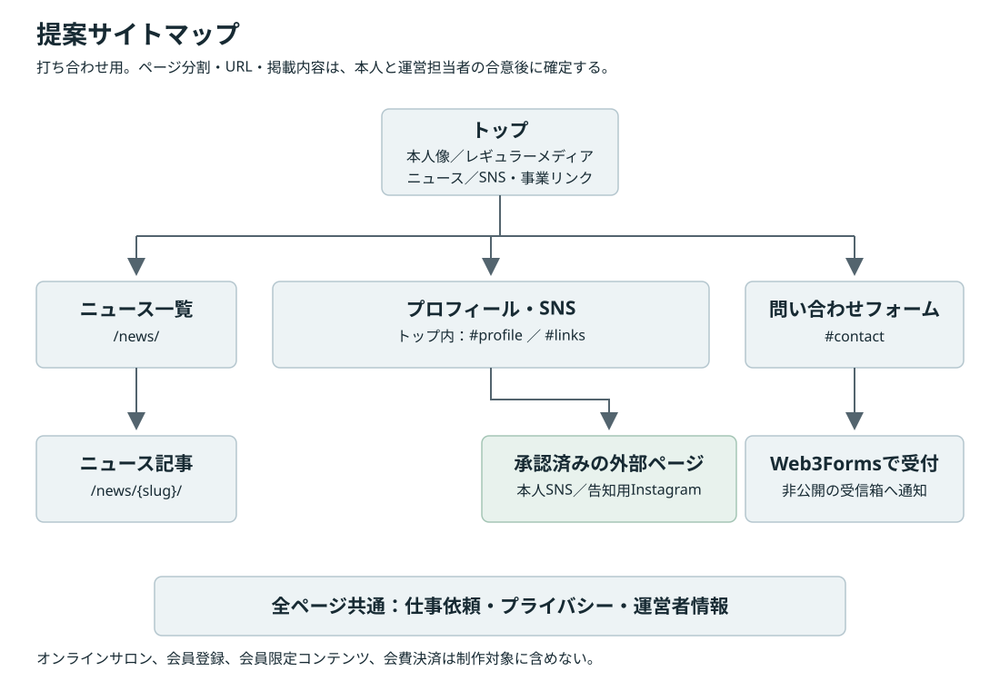
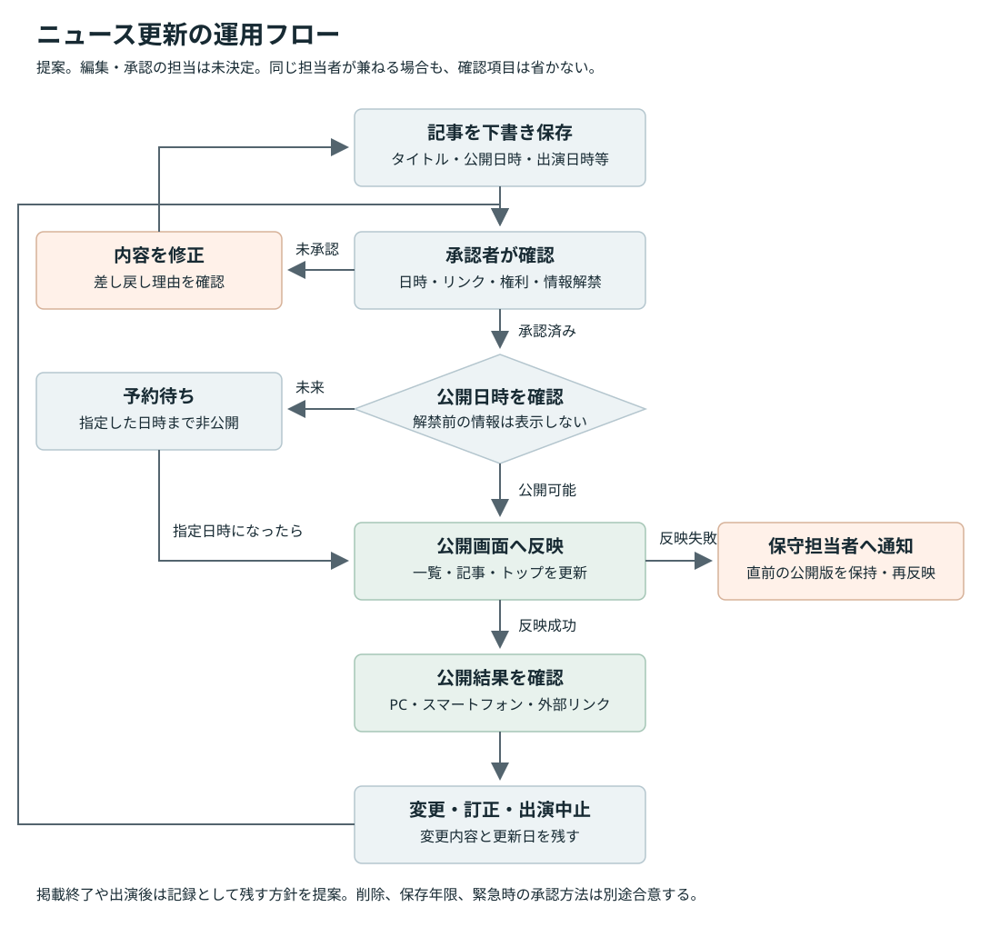
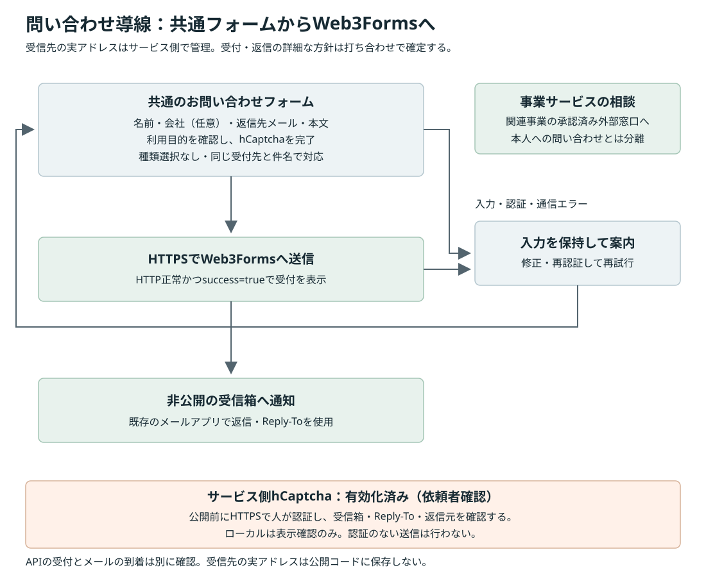

# 岸谷蘭丸 公式サイト 要件定義書

版：v0.17／更新日：2026年10月31日／状態：本人との打ち合わせ用ドラフト。GitHub Pagesでデモ共有。本番はCloudflareを予定。レギュラーは5番組、受信箱確認は未完了

関連資料：[公式サイト比較レポート](./research-report.md)

追加資料：[UIベータの仕様](./beta-ui.md)／[非エンジニア向け更新方法](./media-update-options.md)

v0.2では、PopなベータUIの作成と、非エンジニアが出演情報を更新できる運用の検討を追加しました。ベータは仮写真・架空の出演情報を使い、外部へ公開せずに表示を確認するものです。Googleフォーム・スプレッドシートやCMSの採用・接続はまだ決定していません。

v0.3では、ニュースの前にレギュラーメディアを追加し、地上波・ネット・ラジオでの切替と任意の写真・外部URLに対応しました。出演予定の独立欄を削除し、SNS欄にマネージャー更新のInstagram入口を追加しました。この時点では、実アカウントURLと実際の掲載番組は未設定でした。

v0.4では、レギュラーメディアをPNGロゴ画像だけの一覧に変更しました。番組名・紹介文・放送枠は画像の下に表示せず、カテゴリ切替とロゴから外部サイトへのリンクを残しました。この時点では、独自に作成した透過PNGの仮ロゴを使用していました。

v0.5では、提供されたProfile1をトップに、2枚目の座り姿の写真をプロフィール欄に反映しました。人物・白い縁・網点をまとめて22％拡大し、Aの拡大版とBの胴体多めを比較する機能を追加しました。プロフィールは上半身中心にトリミングし、原本を残して200％程度の拡大も確認しました。

v0.6では、トップをType A、漫画トーンを常時オンに確定しました。SNS案内ボタンの文言と移動先を変更し、各セクション見出しの説明文とレギュラーの件数表示を削除しました。レギュラーは13件の仮データを配置し、マネージャー更新のリンクを「告知用Instagram」の黒文字・下線に変更しました。「告知用」の字面を英大文字の高さに揃え、リンクは中央に配置しています。

v0.7では、マネージャー更新のInstagramへのリンク名を「告知などはこちら」に変更し、下線を他の4つのSNSと同じ長さに揃えました。打ち合わせ用として、文字サイズ・左右・上下をpx単位で調整する仮UIを追加しています。調整値は一時的なもので、本公開では仮UIを外します。

v0.8では、仮UIで確定した文字31px・左右0px・上下＋4pxのPC表示をCSSに固定し、仮UIを削除しました。画面幅に応じた文字の比率を保ち、SNS一覧の3行の間隔を16px広げています。下線の長さは他の4つのSNSと同じままです。

v0.9では、トップのボタンを「プロフィールはこちら」に変更し、移動先をプロフィール欄に変更しました。メインビジュアル下のSNS案内帯は従来どおりSNS欄へ移動します。

v0.10では、SNSの5リンクが確定したことを反映しました。配置は再検討中のため、プロフィール写真・紹介文の下にモノクロロゴと名称を置く統合案をベータに実装しています。リンク内容と既存の移動先を維持した提案であり、統合レイアウトの採用は未決定です。

v0.11では、問い合わせをWeb3Formsによるサイト内フォームへ変更しました。提供された公開用Access Keyを設定し、メディア・一般の種別、入力検証、hCaptcha、重複送信防止、失敗時の入力保持を実装しました。

v0.12では、非公開のローカルファイルから明示的な接続テストを行えるようにしました。実キーのAPI接続と実フォームの送信で、HTTP 200・success=trueを確認しました。当時は公開用HTTPSのhCaptcha条件を維持し、管理画面での必須化と受信箱の着信・返信先確認を本公開前の工程として残していました。

v0.13では、13件の仮データを、提供された4番組に置き換えました。ネット3番組・ラジオ1番組の分類と指定URLを反映し、JPEG・WebPの番組バナーを原本のまま使用しています。画像の外側にあった白い背景と余白を外し、画像全体を青い背景に表示しています。件数非表示は維持し、未登録の地上波では空の状態を案内します。

v0.14では、提供されたSNS5リンクの実アカウントURLを設定しました。本人用と告知用のInstagramを分け、表示名・ロゴ・掲載順・新しいタブで開く動作は維持しました。実URL未設定の案内は削除しました。

v0.15では、問い合わせの種類選択と本文下の補足説明を削除し、共通の受付先・件名に統一しました。hCaptcha有効化の連絡を受け、認証を省略するローカル送信を廃止しています。送信はHTTPSでのhCaptcha認証を必須とします。「新しいタブ」の可視表記は↗に変更し、読み上げ用の案内は残しました。

v0.16では、「ナマリッジ！」をネットに追加し、計5番組（ネット4件・ラジオ1件）に変更しました。提供バナーのファイル名に含まれる全角スペースにも対応しています。既存4番組の掲載順と、画像全体を表示する構成は維持しています。

v0.17では、依頼者指定の `Ryumii/RKHP` リポジトリとGitHub Pagesをデモ共有先に設定しました。仕様書はGitHubで管理し、Web配信用の `dist` にはサイト本体と表示用画像だけを生成します。人物写真の原本・作業用設定はGitHubへのアップロードからも除外しています。共有終了後はPagesを停止してRepoをPrivateにし、本番のCloudflareにはDirect Uploadで公開用ファイルだけを渡す方針です。

本書は、制作範囲と打ち合わせで決める事項を整理した資料です。「確認済み」は依頼者から指定された内容です。「提案」は調査を踏まえた案であり、本人や運営担当者の承認を得た仕様ではありません。デモ共有先はGitHub Pages、本番の公開基盤はCloudflareを予定しています。予算、本番公開日、最終デザイン、CMS、独自ドメインは未決定です。

## 1. 確認済みの目的と制作範囲

### 1.1 確認済み事項

| 項目 | 内容 |
|---|---|
| 制作対象 | 岸谷蘭丸本人の公式サイト |
| 主な目的 | メディア出演情報などのニュース更新、SNSや外部リンクの案内、出演依頼などの問い合わせ先の案内 |
| 進め方 | 本書を使って本人と打ち合わせを行い、合意した要件に基づいて制作する |
| 初期版の問い合わせ | Web3Formsを使うサイト内フォームへ変更。受信先の実アドレスは不特定多数に公開しない |
| 問い合わせの入口 | 種類選択を設けず共通フォームで受け付ける。事業サービスの相談は関連事業の窓口へ案内 |
| 素材 | 人物写真2点を提供済み。トップはProfile1の切り抜き、プロフィールは2枚目を上半身中心に使用。その他の写真・動画や公開条件は未確定 |
| 対象外 | オンラインサロン、および類似する有料会員コミュニティの機能・導線 |
| 今回の成果物 | 調査レポート、要件定義書、説明用の図、デザイン・操作確認用のUIベータ。正式公開はまだ行わない |
| ベータの方向性 | 中田敦彦・武井壮の公開サイトを参考にしたPopな印象。トップはType A、輪郭に沿う漫画トーンは常時オン |
| 更新者の条件 | 非エンジニアでも簡単にメディア出演情報を更新できる運用を目指す |
| レギュラーメディア | ニュース前に番組バナー画像だけを配置。提供された5番組をネット4件・ラジオ1件に分類し、指定URLへリンク。すべて・地上波・ネット・ラジオの切替と件数非表示を維持。外部URLは任意 |
| 出演予定の案内 | 独立した出演予定欄を作らず、「告知などはこちら」からマネージャー更新のInstagramへ案内 |
| SNSの内容 | YouTube、本人Instagram、X、TikTok、告知用Instagramの5リンクで確定。本人と告知用のInstagramは別の入口を維持 |

オンラインサロンのような会員事業は今回扱わない整理とし、会員獲得を主目的とする比較サイトも除外しています。

### 1.2 初期公開に含める案

優先度の「初期」は初期公開に推奨する内容です。依頼者が明示した目的以外の細部は、打ち合わせで採否を決めます。

| ID | 優先度 | 内容 | 決定状況 |
|---|---|---|---|
| N-01 | 初期 | トップの新着表示、ニュース一覧、記事詳細 | ニュース更新の目的は確認済み。画面分割は提案 |
| R-01 | 初期 | レギュラーメディアの分類、番組バナー画像だけの一覧、任意の外部URL。件数カウントは不要 | ご提供の5番組・分類・画像・URLを反映済み。PNG・JPEG・WebPに対応 |
| P-01 | 初期 | 承認済みのプロフィール、現在の活動領域、本人写真 | 提供写真はベータに反映。紹介文・略歴の承認は未完了 |
| L-01 | 初期 | 本人のSNS4つと、出演予定等を案内するマネージャー更新のInstagram | ご指定の5アカウントURLを設定済み。プロフィール統合・ロゴ＋名称は提案 |
| L-02 | 初期 | 本人が関与する事業などの外部リンク | 目的は確認済み。掲載先は未決定 |
| C-01 | 初期 | Web3Formsを使う問い合わせフォーム、入力・認証・送信状態の表示 | 採用確定。hCaptcha有効化は依頼者確認済み。有効化前のAPI受付は確認済みだが、HTTPS実認証・受信箱・返信先は公開前に確認 |
| C-02 | 初期 | 共通フォーム・受付先・件名と事業窓口の区別 | 種類選択を廃止し、1つのキーと共通件名で受付。一般の受付・返信範囲は未決定 |
| O-01 | 初期 | ニュースを継続更新できる運用、更新手順 | 必要な手段・担当者は未決定 |
| Q-01 | 初期 | スマートフォン対応、読みやすさ、キーボード操作、SEOの基本対応 | 品質条件の提案 |
| N-02 | 初期 | ニュースとレギュラーメディアそれぞれのカテゴリ絞り込み | ベータに実装。両方の選択状態は独立して管理 |
| N-03 | 条件付き | ニュースの予約公開 | 編集方法、更新頻度、解禁管理の必要性で判断 |
| M-01 | 条件付き | 動画、音声、ギャラリー、印象的なアニメーション | 素材・表現方針・予算を確認して判断 |
| P-02 | 条件付き | プロフィールPDF、利用許諾付きの広報写真ダウンロード | 依頼元の需要と権利処理を確認して判断 |

### 1.3 初期版に作らないもの

- 問い合わせ用の自前サーバー・データベース。
- 自動返信メール、添付ファイル、サイト側でのメール配送・受付番号の管理。
- 会員登録、ログイン、オンラインサロン、会員限定コンテンツ、会費決済。
- サイト内の物販・チケット決済、一般利用者による投稿。
- 目的が確認されていないSNS自動取り込み、多言語化、予約システム。
- 独立した出演予定一覧。予定の案内はマネージャー更新のInstagramを利用する。

既存の外部サービスへのリンクと、サイト内に同じ機能を実装することは区別します。オンラインサロンの案内は、外部リンクとしても今回の提案に含めません。

## 2. 利用者と優先する行動

| 利用者 | 確認したい情報 | 最短の導線案 |
|---|---|---|
| メディアで知った人・フォロワー | どのような人物か、最近の出演、公式SNS | トップで本人を確認し、ニュースかSNSへ進む |
| 番組制作・取材・イベント・広告の担当者 | 活動領域、実績、依頼先 | プロフィールまたは記事から「メディア・仕事の依頼」へ進む |
| 一般の連絡希望者 | 一般連絡の可否と連絡方法 | 受付方針を読み、フォームで「一般のお問い合わせ」を選ぶ |
| 関連事業の利用希望者 | 留学などのサービス相談先 | 本人の仕事依頼と区別して、承認済みの事業サイトへ進む |

年齢層、流入元の比率、現在の問い合わせ件数は未確認です。調査対象者の年齢、家族関係、フォロワー数から、本人の希望する見せ方や利用者像を決めません。

## 3. サイト構成とトップの順序

### 3.1 サイトマップ案

[](./diagrams/site-map.svg)

図はクリックすると拡大できます。URLは構造を説明するための案であり、フレームワークやホスティングを指定するものではありません。

```text
トップ /
  レギュラーメディア /#regular-media
    番組バナー画像から任意の外部URLへ
  ニュース一覧 /news/
    ニュース記事 /news/{slug}/
  プロフィール・SNS /#profile
    本人紹介・関連事業
    SNSリンク /#links
      YouTube / Instagram / X / TikTok
      告知などはこちら：マネージャー更新のInstagramへ
  問い合わせフォーム /#contact
    メディア・仕事／一般を選び、Web3Formsへ送信
    受信先アドレスはサービス側だけで管理
  プライバシー・運営者情報 /privacy/
```

問い合わせ案内はトップ内のセクションだけにまとめる方法も選べます。固定の案内文が多い場合や、外部に問い合わせ案内のURLを共有したい場合は、独立ページを設ける案が適しています。

### 3.2 トップの掲載順序案

| 順序 | セクション | 掲載内容・役割 |
|---|---|---|
| 1 | ヘッダー | 氏名またはロゴ、レギュラーメディア、ニュース、プロフィール、SNS、問い合わせ |
| 2 | メインビジュアル | 本人写真・映像等、氏名、承認済みの短い肩書き。本人を特定できる情報を文字でも表示し、「プロフィールはこちら」からプロフィール欄へ移動 |
| 3 | レギュラーメディア | カテゴリ切替、番組バナー画像の一覧。URLがあれば画像をリンク化。番組名は代替テキスト・リンク名で伝える |
| 4 | 最新ニュース | 新しい記事を3〜5件程度。公開日、カテゴリ、タイトル、必要なら出演日時 |
| 5 | プロフィール・SNS | 写真、紹介文、関連事業と、名称付きのSNSロゴ5つを同じ欄へまとめる提案 |
| 6 | 問い合わせ | 名前・会社（任意）・返信先メール・本文の入力、利用目的確認、hCaptcha、送信状態 |
| 7 | フッター | 氏名、主要リンク、プライバシー・運営者情報、著作権表記 |

「ニュースを探す」「SNSへ移る」「依頼先を確認する」を、大きなビジュアルや演出の終了まで待たせません。問い合わせへのリンクはヘッダーや記事にも設け、ページ下部まで戻る操作を不要にします。

ニュースを最優先する場合は、メインビジュアルの下端や横にも最新記事への入口を置けます。どちらを採用するかは、本人の見せ方と更新頻度を確認して決めます。

### 3.3 画面構成の概略

配置を説明するための図です。枠線、色、写真のトリミング、フォントを指定するデザイン案ではありません。

```text
PC
+----------------------------------------------------------+
| 氏名・ロゴ   レギュラー  ニュース  プロフィール  SNS  連絡 |
+----------------------------------------------------------+
|                                                          |
| 本人像を伝える写真・映像等      氏名・現在の活動の短い説明 |
|                               プロフィールへの入口       |
|                                                          |
+----------------------------------------------------------+
| 各種SNSはこちらから：SNS欄へ移動                          |
+----------------------------------------------------------+
| レギュラーメディア：すべて／地上波／ネット／ラジオ        |
| 番組バナー画像だけを並べ、URLがあれば画像をリンク化        |
+----------------------------------------------------------+
| 最新ニュース：日付・カテゴリ・タイトル・出演日時          |
| 一覧を見る                                               |
+----------------------------------------------------------+
| プロフィール写真・紹介文・関連事業                         |
| YouTube / Instagram / X / TikTok / 告知用Instagram          |
+----------------------------------------------------------+
| メディア・仕事の依頼         一般のお問い合わせ           |
| フォーム・hCaptcha・送信状態／受信先アドレスは非公開       |
+----------------------------------------------------------+
```

```text
スマートフォン
+------------------------------+
| 氏名・ロゴ      メニュー      |
| 本人像を伝える写真・映像等    |
| 氏名・現在の活動              |
| プロフィールへの入口         |
| 各種SNSはこちらから          |
| レギュラーメディア・分類切替  |
| 最新ニュース                 |
| プロフィール写真・紹介文      |
| 関連事業                     |
| 同じ欄にSNSロゴ5つ＋名称      |
| メディア・仕事の依頼          |
| 一般のお問い合わせ           |
| フッター                     |
+------------------------------+
```

スマートフォンではPC用画像を単純に縮小せず、顔の位置、文字の置き場所、縦横比を別に確認します。画像に組み込まれた氏名や肩書きだけに重要情報を依存させません。

## 4. ニュースと更新運用

### 4.1 記事のデータ

| 項目 | 初期案 | 注意点 |
|---|---|---|
| タイトル | 必須 | 番組名・媒体名・イベント名など、内容を判別できる文言 |
| 記事URL | 必須 | 公開後は原則固定。変更する場合は旧URLから案内 |
| 公開日時 | 必須 | 記事を公開した日時 |
| 更新日時 | 修正時に記録 | 公開日時と混同しない |
| カテゴリ | 原則1つ | TV、ラジオ、Web・配信、イベント、お知らせ等を候補とする |
| 出演・開催日時 | 該当する記事で設定 | 公開日時とは別。海外の予定はタイムゾーンも明示 |
| 本文 | 必須 | 番組・掲載先・出演内容・視聴方法など、掲載許可を得た範囲 |
| 外部URL | 必要な場合 | 番組、記事、配信、主催者などの公式ページ |
| サムネイル | 任意 | 未提供の記事でも、一覧や記事が不自然な空欄にならない構成 |
| 公開状態 | 下書き・公開を区別 | 予約公開は必要な場合だけ採用 |
| 固定表示・掲載終了 | 必要な場合 | 過去の予定をいつまでも最優先表示しない |

最初のカテゴリ案は本人の活動に合わせて整理します。記事が少ない段階で空のカテゴリや複雑な検索機能を作りません。

出演予定の専用表示は作りません。最新の予定は、SNS欄のマネージャー更新Instagramで案内する方針です。ニュース記事に必要な出演・開催日時を記載することとは区別します。

### 4.2 一覧・詳細の表示

- 初期案は公開日時の新しい順です。出演日時で並べた予定一覧は設けません。
- 記事詳細からニュース一覧、公式の視聴・掲載先、仕事依頼へ移動できます。
- 外部記事の見出し・番組ロゴ・写真を使う場合は利用条件を確認します。記事本文を無断で転載しません。
- 出演中止や日時変更は、何が変わったかと更新日を残します。
- 終了した出演情報を実績として残すか、どの期間を一覧に表示するかは打ち合わせで決めます。
- 記事が0件、画像がない、タイトルが長い、外部配信が終了した場合も表示を確認します。

### 4.3 更新フロー案

[](./diagrams/news-workflow.svg)

運営担当者が下書きを作成し、本人または承認担当者が日時・解禁・権利・リンクを確認します。承認者と編集者が同じ場合も、確認項目は残します。予約公開が不要なら、担当者が解禁時刻を確認して手動で公開する方法で構いません。

CMSを使う場合は、下書きやプレビューを一般公開しない設定を選びます。`noindex` だけを未公開情報の保護手段にしません。公開反映に失敗した場合は、担当者が気付けるようにし、直前の公開版を保持します。

## 5. プロフィール、SNS、事業リンク

### 5.1 プロフィール

氏名、読み、英字表記、現在の肩書き、紹介文、掲載したい活動実績を本人に確認します。短い紹介文は100〜250字程度を出発点とし、長い略歴は必要な場合だけ追加する案です。

MMBHの公式発信では、岸谷蘭丸本人がメディア出演と留学関連事業に言及しています。ただし、外部資料の肩書きや在学情報を、そのまま現在の公式プロフィールとして確定しません。詳しい根拠と留意点は[比較レポート](./research-report.md)を参照してください。

家族関係、過去の活動名、学歴、個人的な経歴をどこまで載せるかも本人の判断事項です。知名度のある情報であっても、自動的にプロフィールへ採用しません。

### 5.2 SNS・外部リンク

| 区分 | 表示案 | 公開前の確認 |
|---|---|---|
| 公式SNS | サービス名と、必要ならアカウント名や用途 | 本人が管理・承認した正しいURLか |
| 動画・音声等 | 「動画を見る」「配信を聴く」など、移動先が分かる文言 | 外部サービスの利用条件、公開範囲 |
| 関連事業 | 事業名、短い説明、外部リンク表示 | 本人の現在の関与、紹介文、運営者、相談先 |
| 告知用Instagram | 表示名は「告知などはこちら」。本人用と同じInstagramロゴでも名称で用途を区別 | ご指定の `ranmaru_news_` を設定済み。本人用の `ranmaru_kishitani` とは別の入口を維持 |

SNSをアイコンだけで表す場合も、読み上げ可能な名前を付けます。事業のサービス相談が、本人への出演依頼と同じ窓口に見えないようにします。

初期案は直接リンクを基本とします。埋め込みは一律に採用せず、表示速度、Cookie、障害時の表示、サービス側の仕様変更を確認して決めます。

## 6. Web3Formsによる問い合わせ

### 6.1 初期版の方式

**サイト内の独自デザインのフォームからWeb3Formsへ送信し、事務所側は通知メールで対応する構成に変更します。** ReactやJavaへの移行、自前の送信サーバーは不要です。

受信先の実アドレスはWeb3Forms側で管理し、HTMLやJavaScriptには載せません。公開用Access Keyは設定済みです。これは秘密のAPIキーではなく、フォームの識別子です。

送信にはHTTPSとhCaptchaを必須とします。サービス側のhCaptcha有効化は依頼者から連絡を受けています。ローカルファイル・HTTPからは送信せず、表示と入力の確認だけを行います。公開先の決定、HTTPSでの実認証、受信箱確認は公開前に行います。

### 6.2 共通の受付

メディア・仕事の依頼と一般連絡を一つのフォームで受け付け、入力時の種類選択は設けません。事業サービスへの相談は本人への問い合わせとは分け、関連事業の承認済みサイトへ案内します。

| 受付 | 対象と案内内容 | 通知の件名・移動先 | 決定状況 |
|---|---|---|---|
| 共通のお問い合わせ | 出演・取材等の仕事依頼と一般連絡 | `[お問い合わせ] 岸谷蘭丸公式サイト` | 共通フォームに実装。詳細な受付・返信範囲は要確認 |
| 事業サービスの相談 | 留学などのサービスに関する相談 | 関連事業の承認済みサイトへ案内 | 本人への問い合わせとは分離 |

1つの公開用キーと共通件名を使い、同じWeb3Formsの受付先へ送信します。送信データに種類は含めず、複数の受信先や別部署への振り分けは行いません。

[](./diagrams/contact-flow.svg)

### 6.3 入力項目と保護

| 項目 | 条件 |
|---|---|
| お名前 | 必須、80文字以内 |
| 会社・媒体名 | 任意、120文字以内 |
| 返信先メールアドレス | 必須、254文字以内。通知のReply-Toとして使用 |
| ご相談内容 | 必須、5,000文字以内。本文下の補足説明は表示しない |
| 利用目的・外部送信の確認 | 必須 |
| hCaptcha | HTTPSで必須。外部送信確認後に読み込む。サービス側の有効化は依頼者確認済み。認証なしのローカル送信は行わない |

実アドレス、CC・BCC、メールパスワードはクライアントへ渡しません。送信データは許可した項目だけをJSONにし、HTTPSでWeb3FormsへPOSTします。個人情報をURLのクエリや解析ツールへ入れません。

Web3Forms側のhCaptcha有効化は依頼者確認済みです。本公開前に対象フォームのHTTPS環境で人が認証し、サービス側の設定が適用されることを確認します。受信先・保存期間・通知設定は事務所の管理アカウントで確認し、ローカルから送信するために認証設定を緩めません。

### 6.4 送信状態と実受信の確認

HTTP正常かつWeb3Formsの応答が `success: true` の場合だけ「送信を受け付けました」と表示します。エラー、不正な応答、20秒の期限超過では入力を保持し、自動再送は行いません。送信中は入力と再送信を無効にします。

API受付は、事務所のメール着信や返信の成功を保証しません。公開前に人がhCaptchaを完了して送信し、受信箱・共通件名・Reply-To・返信元アドレスの見え方まで確認します。

## 7. 写真・映像・音声などの表現と必要素材

素材提供前に、特定の媒体やアニメーションへ絞りません。次の選択肢から、本人像、情報の読みやすさ、制作・運用費のバランスで決めます。

### 7.1 表現の選択肢

| 素材・表現 | 使用箇所の例 | 判断する点 |
|---|---|---|
| ポートレート・全身写真 | メインビジュアル、プロフィール | 表情、服装、縦横の構図、文字を置く余白、スマートフォン用の切り取り |
| 切り抜き写真・コラージュ | 本人の個性を強める入口 | 写真の加工許諾、背景とのコントラスト、装飾と情報の重なり |
| 活動風景・掲載実績の画像 | プロフィール、ニュース、任意のギャラリー | 主催者・媒体・共演者の権利、掲載できる期間 |
| 短いループ動画 | トップ、背景以外の独立した映像領域 | 無音、停止方法、静止画への代替、スマートフォンの通信量 |
| インタビュー・出演動画 | 活動紹介、ニュース | 再生は原則利用者の操作から。字幕、権利、埋め込み条件 |
| 音声・ポッドキャスト | 発信先の案内、任意の紹介枠 | 外部リンクだけにするか、再生UIや文字起こしも用意するか |
| ロゴ・サイン・イラスト | 氏名表記、アクセント、画面遷移 | 正式データ、文字としての代替、使用許諾 |
| タイポグラフィ・モーショングラフィックス | 氏名の見せ方、情報の切り替え | 文字の読みやすさ、動きを減らした表示、画像文字への依存 |
| スクロール連動・立体表現・WebGL | 本人像と結び付く場合の特徴的な演出 | 制作費、負荷、操作性、代替表示、更新時の保守範囲 |

単に「豪華にする」ためではなく、本人のどういう面を伝える表現かを説明できる案を選びます。高負荷の演出を採用する場合も、ニュースと問い合わせを利用できる軽い表示を残します。

### 7.2 素材提供時の確認表

| 提供してほしいもの | 推奨する形態の出発点 | 確認事項 |
|---|---|---|
| 本人写真 | 元データ。横位置・縦位置の両方。可能なら長辺2400px以上 | トリミング、色調整、切り抜き、Web利用の許可。提供できる画質で再判断 |
| ロゴ・サイン | SVG、AI、PDF等の原本、または高解像度の透過PNG | 正式な表記、単色版、使用上の制限 |
| 動画 | 元のMP4／MOV等。ループ用は5〜12秒程度の候補も検討 | 音、字幕、横縦の展開、開始・終了、再編集の許可 |
| ニュース用の画像・映像 | 記事と対応する素材、公式の掲載先URL | 写真・番組ロゴ等の権利、情報解禁、掲載終了日 |
| 音声 | 元データ、公開済みURL、必要なら台本・文字起こし | BGM・共演者・配信サービスの許可 |
| テキスト | 氏名表記、肩書き、紹介文、初期ニュース、SNS・事業のURL | 本人の承認、最新性、公開してよい範囲 |
| 問い合わせ情報 | 公開用アドレス、受付範囲、担当、返信方針 | 私用アドレスではないか、一般と仕事で分けるか |

上記の解像度や秒数は素材を確認するための目安です。既存素材が合わないという理由だけで、表現や採用可否を先に決めません。Web掲載用には別途最適化し、元データをそのまま全量配信しません。公開写真の位置情報などの不要なメタデータも除去します。

## 8. 視覚設計と動き

### 8.1 比較する方向性

| 方向性 | 構成の考え方 | 向く場合 | 注意点 |
|---|---|---|---|
| 写真を中心にした構成 | 本人写真と大きな氏名、短い紹介、すぐ使えるリンク | 本人のビジュアルや雰囲気を強く伝えたい | ニュースや問い合わせを写真の後ろに隠さない |
| ニュースを見つけやすい構成 | 写真を保ちつつ、日付・番組名・最新情報を早めに表示 | メディア出演の更新が継続的に多い | 告知が多すぎて本人像が薄くならないようにする |
| 複数の活動を整理する構成 | メディア、発信、事業等の活動を、見出しと代表素材で区別 | 一つの肩書きでは活動を説明しにくい | ページや入口を増やしすぎない |

初期の推奨は「本人写真を中心に、最新ニュースをすぐ下に置く」構成です。色、書体、写真の方向、ロゴ、演出の強さはまだ決めません。調査先のデザインや写真をそのまま移植しません。

### 8.2 文字の大きさと書体の設計目安

以下は本人サイトの提案値です。比較サイトの実測値とは区別します。1pxはCSS上のピクセルです。

| 役割 | PCの出発点 | スマートフォンの出発点 |
|---|---|---|
| 氏名・主見出し | 56〜88px程度 | 32〜48px程度 |
| セクション見出し | 32〜48px程度 | 24〜32px程度 |
| ニュースのタイトル | 18〜24px程度 | 16〜20px程度 |
| 本文・問い合わせ案内 | 16〜18px程度 | 16px以上を基本 |
| 日付・補足 | 14〜16px程度 | 14px程度を基本 |
| 主要ナビゲーション | 16px程度 | 16px程度 |

日本語本文の行間は1.7〜1.9倍程度から確認します。見出しは通常2行以内を目安とし、長い番組名は必要な部分を省かず、領域や改行を調整します。

書体は日本語の読みやすいゴシック体を基準案とし、明朝体や特徴のある欧文書体も比較します。候補例はNoto Sans JP、Noto Serif JP、OS標準の日本語書体です。採用書体は2系統以内を出発点とし、ライセンス、配信方法、実際の日本語の見え方、読み込み失敗時の代替書体を確認します。

### 8.3 アニメーションの選択肢と共通条件

| 強さ | 表現の例 | 確認する条件 |
|---|---|---|
| 控えめ | リンク・メニューの操作反応、短い表示切り替え | 操作後の反応を分かりやすくし、待ち時間を増やさない |
| 中程度 | 写真や文字の段階表示、写真のゆっくりした動き、短い映像ループ | 読む順序が明確か。素材停止時にもページが成立するか |
| 強め | スクロール連動、場面転換、立体・WebGL表現 | 本人らしさに寄与するか。機器負荷と代替表示を確認できるか |

どの強さでも、次を品質条件として提案します。

- 動きが止まっても氏名、ニュース、リンク、問い合わせを読んで操作できること。
- 読み込み演出や強制スクロールを終えるまで、目的の情報を使えない構成にしないこと。
- `prefers-reduced-motion` に応じて移動・点滅・自動ループを減らし、必要な情報を静止表示すること。
- 自動で続く映像や動きには、必要に応じて停止手段を設けること。音声は勝手に再生しないこと。
- JavaScriptや埋め込みサービスに問題があっても、主要情報を非表示のままにしないこと。
- 動きは可能な範囲で `transform` と `opacity` を中心にし、レイアウトの跳ねや操作遅延を防ぐこと。

## 9. 非機能要件の提案

### 9.1 表示・アクセシビリティ

| ID | 提案する条件 | 確認方法 |
|---|---|---|
| Q-01 | 幅360、390、768、1280、1440pxで、文章や主要操作が欠けない | ブラウザ幅ごとの実表示。横スクロールを前提にしない |
| Q-02 | 本文のコントラストは原則4.5:1以上、大きな文字は3:1以上 | 実際の色と画像上の文字で測定 |
| Q-03 | キーボード操作、見えるフォーカス、適切な見出し、画像の代替説明 | 主要ページをキーボードと読み上げで確認 |
| Q-04 | 主要操作は44×44 CSS px程度の押しやすい領域を目標とする | 見た目のアイコン寸法だけでなく操作領域を測定 |
| Q-05 | 200%拡大、文字サイズ変更、動きを減らした設定でも利用できる | 実ブラウザで確認 |
| Q-06 | WCAG 2.2 AAを品質上の目標とする | 自動検査に加えて手動確認。自動検査だけで適合を宣言しない |

実機確認は、少なくともiPhoneのSafariとAndroidのChromeを対象にする案です。対応OS・ブラウザの範囲と試験機は制作時に合意します。PCのウィンドウを狭くした確認だけで、実機対応を完了としません。

### 9.2 表示速度と媒体の配信

Core Web Vitalsの目標案は、実利用者の75パーセンタイルでLCP 2.5秒以下、INP 200ms以下、CLS 0.1以下です。実利用データが十分にない公開前や公開直後には、この条件を達成したと断定しません。

公開前は、同じモバイル計測条件で3回以上測定し、中央値とばらつき、画像・フォント・JavaScript・埋め込みの転送量を記録する案です。Lighthouse等の実験室指標は、実利用者のINPを代替して証明するものではありません。

最初の設計目安は、キャッシュなしのトップ初期表示に必要な転送量を1.5MB以内とする案です。自動再生する動画も除外せずに数えます。素材確認後、映像を使う案では読み込み条件や予算を合意し直します。利用者が操作してから読み込む動画は、初期表示と別に評価します。

画像の適切な寸法、WebP／AVIF等への変換、表示領域に応じた画像選択、下部画像の遅延読み込みを使います。埋め込みやWebフォントは必要なものだけにします。

### 9.3 SEO・公式性

- ページごとのタイトル、説明文、正規URL、OGP、サイトマップを用意します。
- 氏名と活動内容を、画像だけでなく検索できる本文にも記載します。
- 構造化データを使う場合は、本人の `Person` とプロフィールの関係、記事情報を実際の掲載内容に合わせます。`sameAs` は承認済みの公式URLだけにします。
- 古いURLを変更する場合はリダイレクトを計画します。
- 制作中の環境やCMSプレビューは公開サイトと区別し、解禁前の情報を検索・閲覧できないようにします。
- ドメイン、運営者表記、SNSとの相互リンクで公式性を示します。他案件のドメインや連絡先は流用しません。

### 9.4 プライバシー・セキュリティ

問い合わせフォームは氏名、返信先メール、本文等の個人情報を扱います。運営者名、利用目的、保管・削除の方針、国外を含む外部送信先を本公開前に確認します。Web3FormsとhCaptchaの利用を案内し、利用目的を確認するまで認証スクリプトを読み込みません。

HTTPS、管理アカウントの多要素認証、適切な権限、秘密情報を公開コードに含めないこと、依存やCMSの保守、バックアップと復元方法を品質条件として提案します。

Cookieの告知・同意が必要かは、採用するサービスと対象地域に応じて判断します。問い合わせメールの本文、メールアドレス、氏名をアクセス解析へ送信しません。

## 10. 更新方法と技術構成の選び方

### 10.1 更新方法の比較

| 選択肢 | 向く運用 | 確認する負担 |
|---|---|---|
| 管理画面付きのWeb制作サービス | 少人数で更新し、デザイン上の制約を受け入れられる | 月額費用、表現の自由度、移行・エクスポート、権限 |
| ヘッドレスCMSと独自フロントエンド | デザインと記事更新を分離したい | CMSと公開環境の管理、プレビュー、公開反映の仕組み |
| WordPress | 担当者に運用経験があり、保守担当を確保できる | 更新、脆弱性対応、バックアップ、プラグイン管理 |
| 制作担当による静的ファイル更新 | 更新頻度が低く、更新を制作側へ依頼する | 更新費、対応時間、担当者不在時の引き継ぎ |

デモは `Ryumii/RKHP` のGitHub Pagesで共有し、本番はCloudflareを予定しています。フレームワークとCMSは未決定です。問い合わせの送信処理はWeb3Formsに任せ、自前の送信サーバーを用意しません。本公開前にサービス側の認証・受信先・保管設定と実受信を確認します。

ベータはインストール不要のHTML・CSS・JavaScriptで作成しています。これは本番の技術構成や編集方法を確定するものではありません。Googleフォーム＋非公開Sheets＋承認済みデータの公開処理と、microCMS等の比較は[更新方法の提案](./media-update-options.md)を参照してください。回答シートをそのまま公開したり、ブラウザで下書きを隠すだけの方法は採用しません。

### 10.2 運営担当の確認

| 役割 | 主な確認事項 | 現状 |
|---|---|---|
| 本人・ブランド承認者 | 表記、写真、紹介文、見せ方の最終確認 | 担当・承認方法を確認 |
| ニュース編集者 | 原稿作成、日時、外部リンク、更新 | 未決定 |
| 公開承認者 | 解禁時刻、権利、誤記の確認 | 未決定。編集者との兼任も可 |
| 問い合わせの受信担当 | 共通フォームの通知への対応、返信方針 | 未決定 |
| 保守担当 | 障害、ドメイン・契約、CMS、バックアップ | 未決定 |

緊急のお知らせや出演中止を誰が掲載できるか、休日・担当者不在時はどうするかも確認します。更新マニュアルには、通常更新だけでなく訂正・リンク切れ・権利上の削除依頼への対応を含めます。

## 11. 公開前の受入確認案

以下は制作後に実施する試験です。現段階で実装済み、試験済みという意味ではありません。

| ID | 対象 | 合格の確認方法 |
|---|---|---|
| A-01 | N-01 | 新しい記事がトップ・一覧・詳細に反映され、日時とカテゴリが一致する |
| A-02 | N-01・N-03 | 公開日時と出演日時が混同されず、下書き・解禁前の情報が外部から見えない |
| A-03 | O-01 | 決めた担当者が下書き・確認・公開・訂正を行える。採用した方法の手順を渡す |
| A-04 | L-01・L-02 | 本人承認済みのSNS・事業URLに到達し、リンク名と移動先が一致する |
| A-05 | C-01 | 入力・文字数・外部送信確認・hCaptcha必須条件を検証する。本公開前にHTTPSの実認証、受信箱の着信とReply-Toを別途実テストする |
| A-06 | C-02 | 種類選択・種別データを設けず、提供された1つのキー・共通件名で受付する。受信先の実アドレスは公開コードに含めない |
| A-07 | C-01 | HTTP正常かつsuccess=trueだけを受付表示にする。二重送信を防ぎ、エラー時は入力を残す。ローカル・HTTP・設定未完了・認証なしでは送信しない |
| A-08 | Q-01〜Q-06 | 規定幅、実機、キーボード、拡大、コントラスト、動きを減らした表示を確認する |
| A-09 | 性能 | 合意した計測条件・転送量で測定結果を残す。動画を都合よく集計から除外しない |
| A-10 | SEO | ページタイトル、OGP、正規URL、公開・非公開の区分、404を確認する |
| A-11 | 素材 | 写真・映像・ロゴ・音声の利用許諾、クレジット、掲載期間を確認する |
| A-12 | 引き継ぎ | 管理アカウント、原稿・素材、契約の名義、更新方法、バックアップの復元を確認する |
| A-13 | R-01・N-02 | 提供された5番組をネット4件・ラジオ1件として表示し、ニュースとは独立して分類できる。地上波は空の状態を案内する。件数は表示せず、画像の比率と読み上げ名を保ち、指定URLへ移動する |
| A-14 | P-01・L-01 | トップの「プロフィールはこちら」は統合欄上部、下の帯とSNSナビは統合欄内の5リンクへ移動する。本人用と告知用のInstagramを区別でき、既存の移動先を維持する |
| A-15 | P-01・Q-01 | Type Aの構図と漫画トーンを常時表示する。構図比較・トーン切替と、セクション見出し下の装飾的な説明文は表示しない |

入力・API応答の模擬テストと、実際の認証・送信・メール着信を分けます。実送信は運営担当者の了解を得て人がhCaptchaを完了し、受信・返信先を確認します。模擬応答やAPI受付だけで、実受信を合格扱いにしません。

## 12. 効果の確認

最初から成果件数や改善率を約束しません。公開前に比較基準がない指標は、公開後に基準を作ります。

| 目的 | 確認する指標の候補 | 注意点 |
|---|---|---|
| ニュースを継続更新する | 更新頻度、公開漏れ、主要記事の閲覧 | PVだけで正確な情報提供を評価しない |
| 公式SNSへの案内 | サービス別リンククリック | 外部SNSのフォロー完了はサイト側では分からない |
| 問い合わせ受付 | 種別ごとのフォーム送信開始・API受付 | API受付数は実メール着信や有効な相談件数とは異なる |
| 仕事につなげる | 受信担当者が集計する有効な相談件数 | 個人情報を解析ツールへ渡さない |

アクセス解析の採否も未決定です。採用する場合は、個人情報を含まないイベント名で区分します。フォームの氏名・メールアドレス・本文・認証トークンを解析へ送信しません。

## 13. 打ち合わせで決める事項

### 13.1 決定一覧

| ID | 決めること | 比較する選択肢・出発点 | 決定欄 |
|---|---|---|---|
| D-01 | 公式の氏名表記・読み・英字表記 | 本人の正式な表記を確認 | 未決定 |
| D-02 | 前面に出す活動・肩書き | タレント・発信・事業等の比重 | 未決定 |
| D-03 | 目指す本人像と避けたい印象 | 写真中心、ニュース中心、複数活動の整理 | 未決定 |
| D-04 | プロフィールの公開範囲 | 略歴、学歴、過去名義、家族情報等の採否 | 未決定 |
| D-05 | ニュースの種類と更新頻度 | 出演告知、掲載、イベント、お知らせ | 未決定 |
| D-06 | 初期掲載と移行範囲 | ニュースの対象期間、レギュラーの番組名・写真・URL | レギュラー5番組・分類・画像・URLは提供済み。追加分とニュースの移行範囲は未決定 |
| D-07 | ニュースの担当・承認・解禁管理 | 手動更新、CMS、予約公開の要否 | 未決定 |
| D-08 | SNSと事業リンク | 本人・告知用Instagram・事業の正しいURL、表示名、掲載順 | SNSの5リンク・表示名・実URLは指定済み。統合案の採否等は未決定 |
| D-09 | 問い合わせの入口 | 種類選択なしの共通フォーム。一般の受付範囲を確認 | 共通化は確定。詳細な受付範囲は未決定 |
| D-10 | 受信担当・サービス設定 | Web3Forms側の受信先、hCaptcha、保管期間、通知・返信元 | 公開用キー提供済み、hCaptcha有効化は依頼者確認済み。HTTPS実認証・実受信等は確認待ち |
| D-11 | 一般連絡と返信の方針 | ファンレター、個別質問、返信できない内容 | 未決定 |
| D-12 | 事業相談の案内 | 本人への仕事依頼から分けるか、どの事業窓口へ送るか | 未決定 |
| D-13 | 写真・映像等の提供と権利 | 既存素材、追加撮影、加工・公開の範囲 | 未決定 |
| D-14 | 色・書体・演出 | 方向性比較後、静止状態と動く状態を承認 | 未決定 |
| D-15 | 技術・公開・保守 | CMS、ホスティング、ドメイン、契約名義、保守担当 | 未決定 |
| D-16 | 予算と公開希望日 | 初期制作費、継続費、素材準備、公開前確認の日程 | 未決定 |
| D-17 | 解析とプライバシー | 解析の採否、運営者、保管・削除方針 | 未決定 |
| D-18 | 承認と変更管理 | 誰の承認で確定するか、追加要件をどう扱うか | 未決定 |

Web3Formsの採用、受信先の実アドレスを非公開にすること、オンラインサロンを対象外にすることは確認済みです。以前のメール起動のみの方針は変更済みとして扱います。

### 13.2 60分の打ち合わせ案

| 目安 | 議題 | その場で残す記録 |
|---|---|---|
| 10分 | 本人像、目的、優先する利用者 | 肩書き・見せたい活動・避けたい印象 |
| 15分 | トップの順序、ニュース、プロフィール、SNS | 掲載内容と初期記事 |
| 15分 | 参考サイト、写真・映像、文字、動き | 好きな要素・避ける要素・必要素材 |
| 10分 | メディアと一般の種別、受信担当、返信方針 | フォーム運用とサービス設定・実受信の確認担当 |
| 10分 | 更新・保守、予算、公開日、承認 | 担当、未決事項、次回までの確認内容 |

「誰が、何を、いつまでに確認するか」を記録します。本書の作成日を、素材提出日や公開予定日として扱いません。

## 14. 制作開始の条件と引き継ぎ

制作開始前に、少なくとも正式表記、初期公開の範囲、ニュース更新担当、公開用メールアドレス、素材の入手・利用許諾、予算・公開希望日、デザインを承認する人を確認します。技術と公開先は、その運用条件を踏まえて合意します。

進行は、要件確認、画面構成、デザイン比較、PC・スマートフォンのデザイン承認、実装、原稿・素材投入、受入確認、公開、運用引き継ぎの順を提案します。各段階で承認する内容を区切り、合意後の追加は費用・日程への影響を確認します。

引き継ぐものは、サイトのソースまたはサービス管理権限、原稿、利用可能な素材、更新マニュアル、契約・アカウントの所有情報、保守範囲、バックアップ・復元方法です。ドメインやCMSの所有者が制作担当者だけにならないようにします。

## 15. 調査から要件への対応

| 比較から得た判断 | 要件への反映 |
|---|---|
| 写真とSNSだけの構成では、ニュース更新の目的を満たさない | N-01、トップの掲載順序 |
| 活動が複数ある人は、何の情報か分かる分類が必要 | P-01、L-01、L-02 |
| 問い合わせは、入口の対象と連絡手段を分けて考える | C-01、C-02、D-09〜D-12 |
| 仕事依頼と事業サービスの相談は同じ目的ではない | L-02、C-02、D-12 |
| 小さな文字や画像文字の多用は、そのまま模倣しない | Q-01〜Q-06、文字サイズの設計目安 |
| 動画や演出は、再生・読み込みに失敗する条件もある | M-01、動きを減らした表示、静止画等の代替 |
| 見た目だけでなく、情報の更新・訂正・引き継ぎが必要 | O-01、A-01〜A-03、A-12 |

出典、各サイトの観測条件、未確認事項は[公式サイト比較レポート](./research-report.md)にまとめています。比較先の掲載内容や利用者導線は、岸谷蘭丸本人の掲載許可や最終仕様を意味しません。
