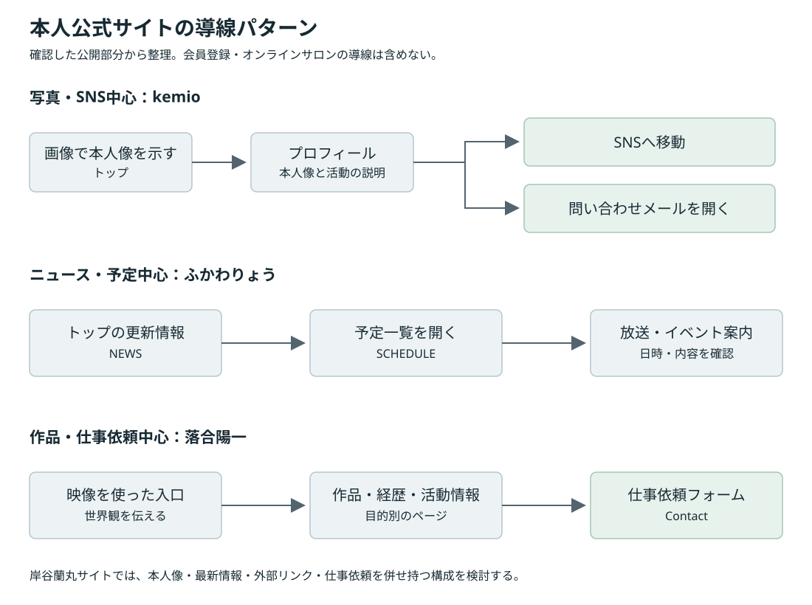

# 岸谷蘭丸 公式サイト制作に向けた比較調査レポート

調査日：2026年10月28日（日本時間）／版：v1.0／用途：本人との打ち合わせ・要件検討

関連資料：[要件定義書](./requirements-definition.md)

## 1. 調査の目的と結論

岸谷蘭丸本人の公式サイトに必要な「ニュース更新」「SNS・外部リンクの案内」「出演依頼等の問い合わせ先」を、実在する日本人男性のタレント・発信者・複数領域で活動する人物の公式サイトから検討します。俳優作品の宣伝を主目的とするサイトより、メディア出演、SNS発信、事業、講演などを併せ持つ例を優先しました。

主比較は10人・10サイトです。このほか、問い合わせの入口を分ける補足例として、出演・取材を受け付ける公開ページを1件だけ扱います。サロン中心のトップページは主比較に数えていません。

結論は次のとおりです。

1. 本人像を伝えるビジュアルと、更新される情報を見つける導線は両方必要です。写真とSNSだけのサイトを、そのまま今回の構成にはできません。
2. 活動が複数ある場合は、プロフィール、発信先、関連事業、仕事依頼を区別すると、訪問者が移動先を判断しやすくなります。
3. 問い合わせは「メディア・仕事と一般の入口を分けるか」「依頼目的で分けるか」「宛先を分けるか」を別々に検討します。フォームの有無だけでは、この違いを説明できません。
4. 初期版は依頼者の指定どおり、メールアプリを開く `mailto:` だけで構成できます。フォームや送信管理は提案しません。
5. 参考サイトの小さい文字、画像に組み込まれた文字、長い演出待ちを、そのまま採用する必要はありません。見た目の参考と、読みやすさ・操作性の条件は分けます。
6. 写真、映像、音声、タイポグラフィ、スクロール連動などの選択肢を残し、後日提供される素材と本人の希望を確認して決めます。

オンラインサロンや類似する有料会員コミュニティは対象外です。一般公開の本人公式サイトに会員向けリンクが含まれる場合も、会員サービスの構成・登録・課金・誘導方法は本調査から除いています。

## 2. 調査方法と根拠の区別

### 2.1 岸谷蘭丸本人との比較軸

[MMBHの公式noteに掲載された本人インタビュー](https://note.com/mmbh_times/n/n29941b3f207a)では、本人がメディア出演、MC・コメンテーター等の活動、留学関連事業について説明しています。[MMBH公式サイト](https://mmbh.co.jp/)も事業側の一次情報として確認しました。

そのため、比較軸は「若い男性」という外見・年代だけでなく、発信者としての本人像、複数の活動、仕事依頼と事業相談の整理に置きました。年齢、在学状況、肩書きなどは資料掲載時点の情報であり、現在の公式プロフィールとしては本人の確認が必要です。家族関係をサイトの主題にする前提は置いていません。

### 2.2 観測条件

| 項目 | 条件・扱い |
|---|---|
| 一次情報 | 公式ページ本体、公開HTML・CSS、ページ内リンクを優先 |
| PC | 主に1440×900 CSS pxのブラウザ表示 |
| スマートフォン幅 | 主に390×844 CSS px。PCブラウザの幅変更であり、実機試験ではない |
| タイポグラフィ | `getComputedStyle` で取得。内側の要素が書体を上書きする場合は、その文字要素を確認 |
| フォント | `font-family` はCSSの指定。読み込み済みのFontFaceも確認したが、日本語の文字単位の実際の代替書体までは特定していない |
| 動き | 実行中のAnimation情報、CSSの設定、HTMLの構造を区別。ライブラリ名だけで動作を断定しない |
| 問い合わせ | 入口、対象者、目的、公開されている宛先・窓口を確認。実送信や登録は行わない |
| 素材 | 公開ページで確認できる画像、ロゴ、動画、外部埋め込み等を整理。素材の再利用許諾までは調べていない |

数値は原則CSS pxです。表では小数を必要に応じて丸めています。OSの描画、Webフォントの読み込み、ブラウザ判定、画面幅で表示は変わります。

### 2.3 根拠の表示

- **実測**：ブラウザのDOM・算出スタイル・Animation情報で確認した値。
- **ソース確認**：HTMLやCSSに設定があることを確認した内容。見た目や再生の成功とは区別します。
- **未確認**：閲覧範囲、環境、未送信等の理由で判断できない内容。「存在しない」という意味ではありません。
- **提案**：調査を踏まえた岸谷蘭丸サイトへの判断。比較先で実施されている事実ではありません。

本調査は導線・構成の比較であり、各サイトの網羅的な品質監査ではありません。売上、問い合わせの成約率、実際の運用体制は確認していません。

## 3. 比較対象と選定理由

近さは活動やサイトの目的に対する本調査上の評価です。人物の評価や、本人の希望するブランド像との一致を示すものではありません。

| ID | 人物・公式ページ | 比較上の近さ | 主に参考にする点 |
|---|---|---|---|
| R01 | [kemio](https://kemio.jp/) | 高：動画・SNS・本人のビジュアルを横断 | 写真、短いプロフィール、SNS、簡潔なメール導線 |
| R02 | [Matt Rose／Life is Art](http://life-is-art-18.com/matt/) | 高：タレント、SNS、音楽・制作等の複数活動 | 本人紹介、ギャラリー、出演情報、SNSの併置 |
| R03 | [中田敦彦](https://www.nakataatsuhiko.com/) | 高：発信・教育コンテンツ・複数の活動 | 活動を分けた紹介、目的別の仕事依頼 |
| R04 | [落合陽一](https://yoichiochiai.com/) | 高：メディア出演と複数分野の活動 | 作品・経歴・活動情報の整理、仕事依頼の明示 |
| R05 | [武田双雲](https://www.souun.net/) | 中：本人像と専門活動・出演等を横断 | 写真、作品、映像、大きな文字、メール案内 |
| R06 | [ふかわりょう](https://www.happynote.jp/) | 中：テレビ、文章、音楽、SNS等の横断 | 更新情報、予定一覧、発信先の集約 |
| R07 | [武井壮](https://gogotakei.com/) | 高：タレント活動、継続的な出演、SNS発信 | ニュースと出演表の区別、SNS集約、メール起動だけの問い合わせ |
| R08 | [箕輪厚介／波の上商店](https://naminoueshoten.com/) | 高：発信・メディア出演・事業の横断 | 本人紹介と事業の関係、連絡目的と受付方針 |
| R09 | [杉村太蔵](https://www.sugimurataizo.com/) | 中：コメンテーター、講演、事業を横断 | 本人の肩書きと出演・講演依頼を早く示す構成 |
| R10 | [尾木直樹／尾木ママ](https://ogimama.jp/) | 中：教育分野の発信とメディア出演 | ニュース・出演・書籍の区別、個別相談の受付方針 |

R02は桑田真澄とMattの共同公式サイト内の本人ページです。比較の対象はMattの公開活動情報であり、共同サイトの構造を岸谷蘭丸サイトへ持ち込むことを推奨するものではありません。

R08は本人の公開プロフィールや活動情報を扱う法人公式サイトです。本人名義のサイトと事業サイトの違いを残して比較し、契約・料金・登録の仕組みは分析しません。残り8件は本人名義の公式サイトとして扱っていますが、ドメインの登録者や実際の運営担当者を個人本人と断定するものではありません。

最初の打ち合わせでは、R01・R02の本人像、R03の仕事依頼、R07のニュース・出演表、R08の事業との整理を優先して見ると、今回の3つの目的を比較しやすくなります。

## 4. サイト別分析

### R01. kemio

**参照先**：[トップ・問い合わせ](https://kemio.jp/)／[主要CSS](https://kemio.jp/assets/css/style.css?v=230907)／[アニメーションCSS](https://kemio.jp/assets/css/animate.css)

**公開部分の順序**

画像を使ったメインビジュアル、PROFILE、本人写真と短い紹介、TikTok・YouTube・Instagram・X、外部ストア、CONTACT、SNSを再掲したフッター、の順です。トップにニュース一覧は確認できませんでした。

**UIと素材**

淡いグレー系の地に、大きな欧文見出しと写真を置く縦長の構成です。PCのプロフィールは写真と説明の横並びで、スマートフォン幅では縦並びになります。メインビジュアルとプロフィールにPC用・スマートフォン用の別画像を指定しています。メインの氏名表示は画像内に含まれるため、その文字にCSSのフォントサイズはありません。

| 実測箇所 | 書体の指定 | PC | 390px幅 |
|---|---|---:|---:|
| PROFILE等の `h2` | Futura PT、300 | 140px | 45.88px |
| プロフィール本文 | Noto Sans CJK JP等、400 | 18px／行高39.6px | 13px／行高28.6px |
| 問い合わせのリンク | 日本語本文系 | 22px | 15px |

Adobe Fontsの読み込みと、Futura PT・Noto Sans CJK JPの読み込み済み状態を確認しました。トップのHTMLに動画・外部動画プレーヤーはありませんでした。

**動き**

`fadeIn` のAnimation情報を確認し、継続時間は2000msでした。WOWによるスクロール表示用の指定もあります。リンクには不透明度を変える約0.3秒の設定があります。設定時間を確認したもので、すべての要素の見え方を実機で評価したわけではありません。

**問い合わせの入口**

CONTACTから1つのメールリンクを開く構成です。メディアと一般を分ける入口や、一般連絡に関する明示的な方針は、確認したトップ内には見当たりませんでした。

**今回に使える点**

本人像、SNS、問い合わせを短い導線で結べます。メール起動だけでも案内を成立させている点が、初期版の参考になります。

**そのまま採用しない点**

ニュース更新の機能は別途必要です。スマートフォン本文13pxや、画像内の文字だけに頼る氏名表示は、読みやすさと検索性の観点で見直す余地があります。

### R02. Matt Rose／Life is Art

**参照先**：[Matt本人ページ](http://life-is-art-18.com/matt/)／[MattのTOPICS](http://life-is-art-18.com/topics/matt/)／[共通CONTACT](http://life-is-art-18.com/contact/)

**公開部分の順序**

共同サイトのロゴ・人物別ナビゲーション、Mattのビジュアル、Instagram、氏名・プロフィール、YouTube埋め込み、GALLERY、TOPICS、BLOG、CM関連の枠、という構成です。人物別のTOPICSがあります。

**UIと素材**

本人写真、名前の入ったビジュアル、経歴、ギャラリーを併せて見せています。PCとスマートフォンでプロフィールのレイアウトを分けるHTMLがあり、スマートフォン幅では写真の後に紹介が続きます。YouTubeはPC用・スマートフォン用の領域に含まれますが、同じ動画の重複要素であり、動画2作品という意味ではありません。

| 実測箇所 | 書体の指定 | PC | 390px幅 |
|---|---|---:|---:|
| 本人名の見出し | Roboto、600 | 35px／行高42px | 29px／行高34.8px |
| プロフィール本文 | 游明朝・Hiragino Mincho ProN等 | 15px／行高26.25px | 15px／行高26.25px |
| GALLERY・TOPICS等 | Roboto、600 | 20px | 20px |

PCの主要ナビゲーションは18pxで、欧文にPoppins、日本語側に明朝体の指定があります。Roboto・Poppinsの読み込み済み状態を確認しました。モバイルメニューの操作性は未検証です。

**動き**

`alpha-in` の1000msのAnimation情報を確認しました。HTMLには、スクロール時の表示、左右からの移動等を指定するクラスがあります。それぞれの移動量や全ギャラリーの操作までは確認していません。

**問い合わせの入口**

人物別の活動ページに対して、CONTACTはサイト共通です。メディアと一般で分けた入口は確認できませんでした。連絡手段はフォームですが、その方式を今回の初期版へ採用する提案はしません。

**今回に使える点**

出演情報だけでなく、SNS、写真、本人の専門的な活動を一緒に提示できます。プロフィールとニュースを別々に充実させる参考になります。

**そのまま採用しない点**

画像や埋め込みを増やすほど、読み込みと更新対象も増えます。素材の権利と掲載期間を管理できる範囲を決める必要があります。

なお、今回の環境ではHTTPの公開ページは取得できましたが、HTTPSの本人ページは証明書名の不一致で開けませんでした。これは本調査時の接続結果であり、すべての閲覧者で同じ状態と断定しません。問い合わせの実送信はしていません。

### R03. 中田敦彦

**参照先**：[本人公式トップ](https://www.nakataatsuhiko.com/)／[仕事の問い合わせ案内](https://www.nakataatsuhiko.com/contact)

**公開部分の順序**

主要ナビゲーション、メッセージ、なりすましSNS・広告への注意、公開動画コンテンツの紹介、制作プロジェクト、プロフィール、関連する公開リンク、フッターの順です。会員向けの案内は分析から除いているため、ここで示すのは対象となる公開部分の順序です。

**UIと素材**

活動ごとの名称、説明、画像、外部に進むボタンを組み合わせています。本人の公式発信先へ案内するだけでなく、偽アカウントへの注意を置いている点は、公式サイトの役割として参考になります。

Wixの見出し要素と内側の文字要素で書体指定が異なるため、見出しタグの指定だけを採用せず、実際に文字を含む内側の要素を計測しました。

| 実測箇所 | 書体の指定 | PC |
|---|---|---:|
| 主要ナビゲーションの文字 | Futura系、700 | 13px |
| メインの日本語メッセージ | MS P明朝・Hiragino Mincho等 | 24px |
| 「YouTube大学」の文字 | `skip` 等、700 | 30px |
| 活動説明 | `skip` 等 | 14px |
| 注意喚起文 | Avenir系 | 15px／行高21px |

390px幅でも本文領域が980px幅のデスクトップ表示として残りました。端末判定の影響を切り分けられていないため、その時の数値を実際のスマートフォン版の値として掲載しません。

**動き**

`motion-revealIn`、`motion-slideIn` の600msのAnimation情報を確認しました。トップの観測範囲では画像を使用し、`video` 要素や `iframe` は確認できませんでした。外部動画へのリンクと、ページ内で再生する動画は区別します。

**問い合わせの入口**

仕事の問い合わせ案内に、次の4つのリンクがあります。

- 番組出演依頼・写真使用依頼。
- 講演依頼・イベント出演依頼。
- PR・案件依頼。
- その他お問い合わせ。

番組出演・写真使用と、残りの目的ではメールの宛先が分かれています。これは「仕事の目的別分岐」であり、「メディアと一般の2入口」とは同じ分類ではありません。ページ全体は仕事に関する問い合わせとして案内されています。

**今回に使える点**

フォームを作らずに、依頼内容に合ったメールリンクを提示しています。岸谷蘭丸サイトでも、2つの入口を同一宛先・件名違いにするか、担当ごとに宛先を分けるかを考える直接的な参考です。

**そのまま採用しない点**

目的の分類を細かくしすぎると、依頼者が選択に迷います。初期版では、実際の担当分担に必要な分類だけを使います。

### R04. 落合陽一

**参照先**：[トップ](https://yoichiochiai.com/)／[Information](https://yoichiochiai.com/information)／[Biography](https://yoichiochiai.com/biography)／[Contact](https://yoichiochiai.com/contact)

**公開部分の構成**

トップは映像を使う入口と短い言葉、作品への入口を中心とし、ナビゲーションでInformation、Art、Exhibition、Artist Statement、Biography、Sales、Contactを分けています。公開される活動情報、作品、経歴、依頼を、1本の長いプロフィールだけにまとめない構造です。

**UIと素材**

暗い背景、細い欧文書体、大きな余白、日本語の明朝体という対比があります。トップにYouTubeの埋め込みを確認しました。プロフィール・作品ページとは別に、仕事依頼の目的をContactで説明しています。

| 実測箇所 | 書体の指定 | PC | 390px幅 |
|---|---|---:|---:|
| 主要ナビゲーション | Prompt等 | 14px | メニュー内用の指定は14px |
| トップの短い日本語文 | Noto Serif JP等 | 12px／行高30px | 11px／行高22px |
| Contactの主見出し | Prompt等 | 64px／行高76.8px | 42px／行高50.4px |
| Contactの日本語案内 | Noto Serif JP等 | 16px／行高32px | 14px／行高25.2px |

PromptとNoto Serif JPの読み込み済み状態を確認しました。Contactの小さな注意書きは10pxでした。印象的な書体設計と、重要な説明の可読性は別に評価する必要があります。

**動き**

トップの埋め込みURLに無音・ループ等の設定があります。ただし今回の環境ではトップのローディング画面が残る場面があり、背景映像の正常な再生完了は確認できませんでした。CSSには4000ms等のAnimation情報、リンクには約0.3秒の変化設定があります。

この観測だけで通常利用時の不具合とは断定できませんが、外部動画やローディング処理に依存して主要情報を隠さないという設計上の注意点になります。

**問い合わせの入口**

Contactには、講演・取材、制作・展示、作品購入、その他の仕事依頼を列挙しています。個人的な質問には回答できない場合がある旨の注意があります。メディアと一般を別入口にするより、「仕事依頼の共通入口で、受付範囲を説明する」構成です。連絡手段はフォームです。

**今回に使える点**

活動が一つの職業名に収まらない人物でも、目的別のナビゲーションと仕事依頼の説明を用意できます。一般の質問に対する方針を案内する点も参考です。

**そのまま採用しない点**

作品中心の深い階層や多数の外部リンクは、岸谷蘭丸の実際の掲載内容に合わせて減らせます。小さい文字や映像の読み込み待ちを、雰囲気のために再現する必要はありません。

### R05. 武田双雲

**参照先**：[トップ](https://www.souun.net/)／[News](https://www.souun.net/news)／[Exhibition info](https://www.souun.net/exhibitioninfo)／[Contact](https://www.souun.net/contact)

**公開部分の順序**

ロゴとナビゲーション、本人名、本人写真、活動の短い説明、展覧会情報、動画、作品や素材別の紹介、サイトマップとSNSを含むフッター、という長い構成です。

**UIと素材**

本人のポートレートだけでなく、作品写真、素材、映像、個性的な欧文書体を使っています。手書きのロゴとデジタルの大きな文字も併置しています。大きな文字は主見出しだけでなく、ページ途中の表現にも使われています。

| 実測箇所 | 書体の指定 | PC | 390px幅 |
|---|---|---:|---:|
| 本人名の主見出し | `calder-dark-grit` | 58.2px | 40.32px |
| 展覧会の見出し | `calder-dark-grit` | 56.1px | 40px |
| 展覧会の説明 | `courier-std` | 23.64px／行高31.32px | 20.06px／行高26.58px |
| 主要ナビゲーション | `aktiv-grotesk` | 13.27px | 別メニューを使用 |

ページ途中の「ART it」はPCで約306px、390px幅で約79.8pxでした。これは装飾性の高い大見出しの値であり、本文の大きさではありません。指定された欧文書体が日本語の字形も描画しているとは限りません。

**動き**

無音・自動再生・ループを設定した `video` 要素と、繰り返すテキストを使うマルキー用のDOMを確認しました。ただし動画は計測時に停止状態で、再生可能状態も途中だったため、連続再生の成功とは扱いません。マルキーの実際の移動速度も未確認です。リンクや要素のCSSには0.14〜0.4秒等の変化設定があります。

**問い合わせの入口**

Contactではメールアドレスを示し、会社名、名前、電話番号、メールアドレス、用件を記入するよう案内しています。確認したページに入力フォームはありませんでした。メディアと一般の別入口はなく、メール本文に必要な情報を案内する構成です。

**今回に使える点**

写真だけに限定せず、本人の活動から素材や動きを展開する参考になります。メール起動方式でも、依頼のために何を書いてほしいかを伝えられます。

**そのまま採用しない点**

長い作品紹介は、掲載する実際の活動量に見合う場合だけ採用します。本文の書体を含めて多くの欧文書体を読み込む構成は、日本語サイトでは必要性と負荷を見直します。

### R06. ふかわりょう／Happy Note

**参照先**：[トップ](https://www.happynote.jp/)／[SCHEDULE](https://www.happynote.jp/schedule/index.html)／[LINKS](https://www.happynote.jp/works/index.html)

**公開部分の順序**

ロゴ、画像を使ったナビゲーション、言葉・告知バナー、音楽・文章・写真・予定の入口、NEWS、フッターの構成です。NEWSには「SCHEDULEを更新しました」という日付付きの案内が並び、予定一覧に移動できます。

**UIと素材**

MUSIC、WORDS、PHOTO、SCHEDULE、LINKSを分け、複数の発信形式を「何をするか」で案内しています。LINKSにはSNSだけでなく、音声配信、書籍、活動別のページ等をまとめています。トップのナビゲーションには画像が使われています。

| 実測箇所 | 書体の指定 | PC | 390px幅 |
|---|---|---:|---:|
| NEWSの見出し | Montserrat・Arial・游ゴシック等 | 16px | 16px |
| 「音楽を聴く」等の案内 | 同上 | 14px／行高21px | 14px／行高21px |
| NEWSの日付 | 同上 | 14.4px／行高21.6px | 12px／行高18px |

**動き**

観測時に300msの変化情報がありましたが、初期表示のすべての動作は特定していません。トップの調査範囲では `video` や `iframe` は確認できませんでした。音楽・音声の発信先があることと、トップで音声を自動再生することは別です。

**問い合わせの入口**

トップとLINKSの調査範囲では、仕事依頼や一般問い合わせへ直結する入口を確認できませんでした。サイト全体に問い合わせ先が存在しない、と断定するものではありません。

**今回に使える点**

本人の活動を「音楽を聴く」「文章を読む」「予定をみる」と、訪問者の行動で整理できます。SNS以外の発信も含めた案内と、定期的な予定更新の参考になります。

**そのまま採用しない点**

更新告知だけでは、訪問者が番組名や出演日時をトップで把握できません。今回のニュースでは、可能な範囲で具体的な内容をタイトルと日時に出す案を推奨します。仕事依頼は、トップから直接見つけられるようにします。

### R07. 武井壮

**参照先**：[武井壮公式サイト](https://gogotakei.com/)

**公開部分の順序**

HOME、NEWS、MEDIA、PROFILE、SNS、CONTACTを1ページで配置しています。NEWSは随時の告知、MEDIAは週間の出演情報という区別があります。調査範囲では2026年10月25〜26日付の更新を確認しました。

**UIと素材**

セクションへ進むナビゲーションと、PC用・スマートフォン用の別領域を使う構成です。SNSはX、Instagram、TikTok、YouTube、Facebook、Threadsの6媒体を案内し、一部にスタッフ側の発信先もあります。画像とアイコンを使用し、計測したトップには `video` や `iframe` はありませんでした。YouTubeの案内は外部リンクです。

| 実測箇所 | 書体の指定 | 計測値 |
|---|---|---:|
| PCのニュース見出し文 | Noto Sans JP、600 | 14px／行高16.8px |
| PCのHOMEナビゲーション | 総称 `sans-serif` | 16px／行高16px |
| 390px幅のニュース日付 | Noto Sans JP、700 | 12px／行高14.4px |

PCの見出し文とスマートフォン幅の日付は別の部品です。14pxから12pxへ縮小した同一要素の比較ではありません。スマートフォン幅ではPC側の文字ナビゲーションが非表示になり、別のナビゲーション操作は調査内で確認できませんでした。

**動き**

PCのナビゲーションには0.3秒の変化設定があります。これはCSSの確認であり、実際のホバー発火や全セクションの表示演出までは確認していません。

**問い合わせの入口**

CONTACTはスタッフ宛てのメールリンク1つです。メディアと一般、番組と講演等の目的ごとの別入口や、一般連絡への返信方針は確認できませんでした。フォームを作らずにメールを起動する例として、今回の初期方式に直接対応します。

**今回に使える点**

ニュースと出演予定を分ける発想、SNSをまとめる位置、簡潔なメール案内が参考になります。出演予定が多ければ、ニュース記事の並びだけに頼らず、今後の予定を別に表示する案を検討できます。

**そのまま採用しない点**

PC・スマートフォンの領域を別々に管理する場合は、更新内容の不一致に注意が必要です。スタッフ宛てのメール構成は、その人物の運営体制に依存します。岸谷蘭丸の受信担当を確認せずに同じ分担を前提にしません。

### R08. 箕輪厚介／波の上商店

**参照先**：[波の上商店](https://naminoueshoten.com/)／[問い合わせ](https://naminoueshoten.com/contact)

**公開部分の順序**

ヘッダーナビゲーション、短いコピー、news、会社・活動の説明、代表プロフィールへの入口、という構成です。ナビゲーションには事業紹介、代表プロフィール、会社概要、実績、問い合わせなどがあります。

本サイトは法人の事業案内も兼ねています。比較対象は本人の活動・プロフィールへの案内、ニュース、SNS、公開の連絡導線に限定し、顧問サービス等の販売・契約・料金・登録は対象外としています。

**UIと素材**

短いコピーと少数の画像を使い、X、Instagram、YouTube、LINE公式を案内しています。計測したトップに `video` や `iframe` はありませんでした。スマートフォン幅ではメニューボタンからリンク群を展開できることを操作で確認しています。

| 実測箇所 | 書体の指定 | PC | 390px幅 |
|---|---|---:|---:|
| 本文・コピー | A1ゴシック R JIS2004 | 16px／行高20.8px | 16px／行高20.8px |
| ナビゲーション | PCはA1ゴシック M、展開後のモバイルはR | 16px／行高16px | 16px／行高22.4px |

同名のWebフォントの読み込み済み状態を確認しています。トップで確認した文字付きの要素からは、通常の `h1`・`h2` による見出しを特定できませんでした。これは構造上の観測であり、その事実だけで検索順位への影響を断定するものではありません。

**動き**

モバイルメニューが開閉することを確認しました。開閉の動きがスライドかフェードか、継続時間が何秒かは未確認です。ライブラリ名が見つからないことを、アニメーションが存在しない根拠にはしていません。

**問い合わせの入口**

共通の問い合わせ先で、講演・取材、事業に関する相談、その他等の目的を選ぶ構成です。メディアと一般・ファン向けが別入口として独立しているわけではありません。営業・勧誘の連絡を受け付けない旨の注意書きがあり、受付範囲を明示しています。

**今回に使える点**

本人への仕事依頼と事業に関する問い合わせを、同じ窓口にまとめるか分けるかを検討する比較例です。受け付けない連絡の種類を文章で示す点も、メール方式に置き換えて参考にできます。

**そのまま採用しない点**

法人への依頼と個人へのメディア依頼を、そのまま同じ分類にすると、連絡者が迷う場合があります。岸谷蘭丸サイトでは、本人の出演依頼、一般連絡、留学等の事業相談を分けて検討します。newsの記事日付は抽出できなかったため、更新頻度は判断していません。

### R09. 杉村太蔵

**参照先**：[杉村太蔵公式サイト](https://www.sugimurataizo.com/)

**公開部分の順序**

大きな本人名、現在の肩書き、講演・番組等の出演依頼の案内、問い合わせ、その後にテレビ出演・雑誌掲載等のニュース見出しが並びます。

**UIと素材**

本人名を大きく示し、依頼先を早い位置に置いています。プロフィールや講演実績のページもありますが、常設ナビゲーションで確認できたのはHomeでした。トップには画像を使い、Xへのリンクを確認しました。計測したトップに `video` や `iframe` はありませんでした。

| 実測箇所 | 書体の指定 | 計測値 |
|---|---|---:|
| 本人名の主見出し要素 | `k2d, sans-serif` | PC・390px幅とも90px／行高54px |
| PCの肩書き文 | Cormorant Garamond系等 | 24px／行高33.6px |
| PCのニュース見出し | `madefor-text` 等 | 16px |
| PCのHomeナビゲーション | Arial・Helvetica等 | 10px |

スマートフォン幅ではHomeリンクは非表示でした。ニュース見出しに指定された書体と同名のWebフォントの読み込みは確認できていません。`k2d` や欧文書体が日本語を描画する実際の書体を示しているとは限りません。主見出しの算出値だけで、実機での文字の重なりや見切れを断定していません。

**動き**

このサイトの表示演出の種類・継続時間は特定できていません。制作基盤の名前や画像のファイル名だけから、アニメーションや素材の制作方法を推定していません。

**問い合わせの入口**

トップに仕事依頼向けの共通フォームがあります。メディアと一般の独立した入口や、仕事の目的を選ぶ分岐は確認できませんでした。案内文が講演・番組出演の依頼を対象としている点は確認できます。フォームを今回に採用する提案ではありません。

**今回に使える点**

初めて訪れた担当者に、誰の公式サイトで、どの依頼ができるかを早く示せます。この考え方をメール起動リンクに置き換えることはできます。

**そのまま採用しない点**

画面の大半を占める大きな本人名や、常設メニューが少ない構成は、ニュースを探す目的と両立できるか確認が必要です。ニュース見出しの個別日付は抽出できなかったため、更新頻度や情報の鮮度は判断していません。

### R10. 尾木直樹／尾木ママ

**参照先**：[尾木ママ公式サイト](https://ogimama.jp/)／[出演情報](https://ogimama.jp/media/)／[問い合わせ](https://ogimama.jp/contact/)

**公開部分の順序**

ナビゲーションと画像を使ったメイン領域、プロフィールへの入口、News、書籍情報、出演情報、研究所案内やSNSを含むフッター、の順です。教育分野の発信、メディア出演、書籍を区別して案内しています。

**UIと素材**

ロゴ画像、背景画像、書籍の表紙などを使用し、Instagram・Amebaブログ・TikTokを案内しています。公式に使うSNSの種類を文章でも示しています。計測したトップに `video` や `iframe` はありませんでした。

| 実測箇所 | 書体の指定 | PC | 390px幅 |
|---|---|---:|---:|
| Newsの見出し | Quicksand、600 | 32px／行高57.6px | 21px／行高33.6px |
| ニュース本文・見出し文 | Noto Sans JP | 16px／行高28.8px | 14px／行高22.4px |
| 書籍情報等の見出し | Noto Sans JP、500 | 24px／行高43.2px | 18px／行高28.8px |

Noto Sans JPとQuicksandの読み込み済み状態を確認しました。

**動き**

トップの一部で400msの変化情報を確認しましたが、その対象や全ページの表示演出は特定していません。

**更新情報の状態**

観測したNewsには「21.04.01」「25.06.02」の表記があり、出演情報の枠は投稿がない旨を表示していました。この範囲の表示を、本人が活動を停止した証拠とは扱いません。記事0件や掲載対象のない期間の表示も設計する必要がある、という比較例です。

**問い合わせの入口**

問い合わせページは仕事・講演向けの共通フォームです。電話やメールフォームによる相談・カウンセリングは原則行わない旨と、面談業務を休止している旨を明示しています。メディアと一般を2つに分ける構造ではなく、「仕事の入口を用意し、個別相談の受付方針を説明する」構造です。

**今回に使える点**

教育に関わる発信をしていても、個人の学習相談やカウンセリングを本人サイトで受け付けるとは限らないことが分かります。岸谷蘭丸サイトでも、事業サービスの相談と本人への連絡を分け、回答できない内容を必要に応じて説明する参考になります。

**そのまま採用しない点**

書籍・研究所の区分はその人物の活動に応じたものです。岸谷蘭丸にない内容を増やす必要はありません。出演情報がない場合の表示や、長く固定する注意書きと最新ニュースの区別は、更新方針を決めたうえで整えます。

## 5. コンテンツと導線の横断比較

### 5.1 主な構成の違い

| ID | ニュース・予定 | 本人紹介・活動の整理 | SNS・外部リンク | 主に確認した素材 |
|---|---|---|---|---|
| R01 | トップに一覧は未確認 | 短いPROFILE | SNSを本文・フッターに配置 | メイン画像、本人写真、画像アイコン |
| R02 | 人物別TOPICS | 経歴、作品・出演等 | Instagram、動画等 | 写真、ギャラリー、YouTube、ロゴ |
| R03 | トップに専用新着一覧は未確認 | 活動別紹介、プロフィール | 公開動画、制作物等 | 画像、日本語のメッセージ、外部動画リンク |
| R04 | Information・Exhibition | 作品、声明、経歴等に分割 | SNS・複数の活動先 | YouTube埋め込み、作品等 |
| R05 | News・Exhibition info | 本人と作品領域を併置 | Instagram、X等 | ポートレート、作品写真、動画、ロゴ |
| R06 | NEWSとSCHEDULE | 音楽・文章・写真等で分類 | LINKSにSNS・音声等を集約 | 画像ナビ、告知画像、写真、外部配信リンク |
| R07 | NEWSと週間MEDIA | 同じページにPROFILE | SNS6媒体を集約 | 画像、アイコン、外部動画リンク |
| R08 | news | 法人の活動説明と代表プロフィール | SNS4媒体 | 画像、文字のコピー、メニュー |
| R09 | ニュース見出し | 肩書き、プロフィール・講演実績 | Xを確認 | 画像、大きな本人名 |
| R10 | News、出演情報、書籍情報 | プロフィール、研究所案内 | Instagram・ブログ・TikTok | ロゴ、背景、書籍表紙 |

「ニュース」という名前があるかだけでなく、番組名・日時を直接見つけられるか、予定と更新告知が分かれているかを確認することが重要です。

### 5.2 公開サイトで見られる導線の型

図はクリックすると拡大できます。各サイトの完全なサイトマップではなく、確認した公開部分から特徴を整理したものです。

今回のサイトでは、本人像を示す入口、最新ニュース、プロフィール、SNS・関連事業、問い合わせ案内を組み合わせる案が適しています。写真中心の構成と情報更新型の構成は、どちらか一方に絞る必要はありません。

## 6. 問い合わせの構成

### 6.1 入口の対象・目的・手段

「その他お問い合わせ」があるだけでは、一般・ファン向けの入口が独立しているとは判断していません。仕事依頼の説明の中の「その他」であれば、仕事の目的別分類として記録しています。

| ID | メディア・仕事と一般の別入口 | 確認した分け方・受付方針 | 手段・宛先 |
|---|---|---|---|
| R01 | 別入口は未確認 | CONTACTを共通で提示 | 1つのメールリンク |
| R02 | 別入口は未確認 | 人物別ページに対してCONTACTは共通 | 共通フォーム |
| R03 | 一般向けの独立入口は未確認 | 番組・写真使用、講演・イベント、PR、その他の仕事 | 目的別のメールリンク。宛先は2系統 |
| R04 | 別入口は未確認 | 仕事の種類を列挙。個人的な質問は回答できない場合がある旨を記載 | 仕事依頼の共通フォーム |
| R05 | 別入口は未確認 | メールに記載してほしい情報を案内 | 共通のメールリンク |
| R06 | 調査範囲で窓口未確認 | トップ・LINKSでは判断不可 | 未確認 |
| R07 | 別入口は未確認 | CONTACTを共通で提示 | スタッフ宛てのメールリンク |
| R08 | 一般・ファン向けの独立入口は未確認 | 共通窓口で仕事・事業等の目的を選択。営業・勧誘の受付制限を記載 | 共通フォーム |
| R09 | 別入口は未確認 | 講演・番組等の出演依頼を案内 | トップの共通フォーム |
| R10 | 別入口は未確認 | 仕事・講演用。個別相談等は原則受け付けない旨を説明 | 共通フォーム |

実際の受信担当、別アドレスが同じ受信箱に入るか、転送・振り分けの仕組み、返信の実態は外部から確認できません。公開された入口と実際の社内運用を同一視しません。

主比較10件の確認範囲では、「メディア向け」と「一般・ファン向け」を明示的に分けた2入口は確認していません。共通窓口、仕事の目的別の案内、受付範囲の注意書きが中心でした。未確認のページや社内の振り分けがないと断定するものではありません。

### 6.2 補足：公開の仕事依頼と別系統の問い合わせリンク

[西野亮廣への出演・取材・講演依頼ページ](https://chimney.town/contact/)は、本人の仕事依頼を扱う公開の窓口です。同ページ等のフッターには、業務窓口とは別に「お問い合わせ」というリンクがあり、外部Zendeskの[新規リクエストページ](https://akihironishino.zendesk.com/hc/ja/requests/new)へ向けられています。

原文に「一般」という文言はなく、リンク先は取得時に403で本文を確認できませんでした。会社や商品への問い合わせか、本人への一般メッセージか、ファンレターかは未確認です。「仕事依頼と別の問い合わせリンクがある」という事実だけを補足例として扱い、「メディアとファンの2入口がある」とは断定しません。

運営サイトのトップはサロンの案内が中心だったため、そのトップの構成・フォント・素材・会員誘導は本レポートの分析と主比較10件から除外しました。ここでは公開の仕事依頼ページと窓口の分け方だけを参照しています。

### 6.3 岸谷蘭丸サイトの比較案

| 案 | 画面上の入口 | 運用の違い | 判断 |
|---|---|---|---|
| 共通入口 | 「お問い合わせ」1つ | 案内が最も少ないが、連絡の種類を区別しにくい | 一般と仕事の対応が同じ場合に検討 |
| 対象者別の2入口 | 「メディア・仕事の依頼」「一般のお問い合わせ」 | 同じ宛先・件名違いでも構成できる | 今回の打ち合わせの出発点として推奨 |
| 仕事をさらに目的別に分類 | 番組、取材、広告、講演等 | 実際に担当や受付条件が異なる場合に役立つ | 初期版で必要な分類だけにする |

これに、留学等の事業相談を外部の事業窓口へ案内するかを別に判断します。事業の顧客対応と本人の仕事依頼を、見た目だけで同じ窓口にしないためです。

いずれの案も初期版は `mailto:` だけにします。メールアプリが開かない人のために、公開アドレスを読んでコピーできる表示を添えます。サイト内の送信処理、受付完了画面、自動返信は不要です。

## 7. フォントと文字サイズの読み取り

### 7.1 実測から分かること

- kemioでは140pxの欧文見出しと18pxの本文という大きな差があります。一方、スマートフォン本文は13pxです。見出しの印象と、本文の読みやすさは別に判断します。
- Mattでは、本人名35px、本文15px、セクション20pxと、比較的近い大きさの階層です。写真とギャラリーが本人像を伝えています。
- 中田敦彦では、ナビゲーション、メインの日本語メッセージ、活動名、説明で書体を変えています。親の見出しタグだけの計測では、実際の文字の書体を取り違えることが分かります。
- 落合陽一では、欧文のPromptと日本語の明朝体を対比させています。大きなContact見出しと、小さい短文・注意書きの差が特徴です。
- 武田双雲では、個性的な欧文、大きな展示説明、非常に大きな途中見出しを使っています。一般的なタレントの告知ページとは異なる作品紹介の表現です。
- ふかわりょうでは、画像ナビと小さなNEWS・日付を使い、活動の分類と外部リンクに役割を持たせています。
- 武井壮では、PCのニュース見出しと、スマートフォンの日付のように、別部品を同じ役割の文字として比較しない注意が必要です。
- 箕輪厚介の法人サイトでは、日本語Webフォントと16pxのコピー・メニューを使っています。文字の大きさだけでなく、見出しとしての文書構造も分けて確認します。
- 杉村太蔵では、主見出し要素がPC・スマートフォン幅とも90pxでした。算出サイズだけでなく、実機での表示・改行・ナビゲーションと合わせた確認が必要です。
- 尾木ママでは、欧文見出しのQuicksandと日本語本文のNoto Sans JPを使っています。ニュース、書籍、出演情報の階層を文字サイズでも分けています。

これらの大きさを平均して、新しいサイトの適正値とすることはできません。今回の基本案は、日本語本文をスマートフォンでも16px以上から検討し、氏名・見出しと十分な差を付ける構成です。具体的な提案値は[要件定義書](./requirements-definition.md)に分けて記載しています。

### 7.2 書体を決める際の確認

CSSに欧文書体名が書かれていても、その書体が日本語の字形を持たない場合は別の書体で描画されます。名称の印象だけで採用せず、実際の氏名、肩書き、番組名、長い記事で確認します。

画像内の文字はCSS pxの文字サイズとして計測できません。拡大、検索、読み上げ、差し替えの負担も異なります。氏名・現在の肩書き・ニュース本文は、原則として文字でも用意する案を推奨します。

## 8. マルチメディア素材とアニメーション

本書でいうマルチメディア素材は、写真、動画、音声、ロゴ・サイン、イラスト、タイポグラフィ、外部埋め込み等です。実際に存在する素材と、今後選べる表現を区別します。

| 表現 | 調査で確認した例 | 岸谷蘭丸サイトで判断すること |
|---|---|---|
| 画像を使ったメインビジュアル | kemio、Matt | 氏名を画像だけに含めるか、写真と文字を別にするか。縦横の別素材 |
| 本人写真とプロフィール | kemio、Matt、武田双雲等 | 親しみやすさ、仕事向けの信頼感、服装・背景・トリミング |
| 作品・活動ギャラリー | Matt、武田双雲 | 掲載する実績、権利、更新を継続できる量 |
| 外部動画の埋め込み | Matt、落合陽一 | 権利、読み込み、Cookie、障害時の代替リンク |
| 自前の動画要素 | 武田双雲 | 無音、停止方法、静止画、スマートフォンでの読み込み条件 |
| 音声・ポッドキャストの案内 | ふかわりょうのLINKS | リンクだけにするか、再生UI・説明・文字起こしも設けるか |
| 画像のナビ・ロゴ | kemio、Matt、ふかわりょう、尾木ママ等 | 読み上げ名、画像内文字、表示解像度、差し替え方法 |
| 大きな欧文・文字の表現 | kemio、武田双雲、杉村太蔵等 | 本人らしい意味があるか。日本語の主要情報を小さくしないか |
| 表示時のフェード・移動 | kemio、Matt、中田敦彦等 | 速さ、情報の順序、読み込み失敗時の表示 |
| マルキー・繰り返す文字 | 武田双雲の構造を確認 | 実際の動作は未検証。採用する場合は停止と読みやすさを確認 |

本調査で存在を確認していないWebGL、3D、独自のスクロール演出なども、今後の検討から禁止するものではありません。素材と本人の方向性に合い、負荷・操作・保守・代替表示の条件を満たせるかで判断します。

逆に、比較サイトに動画や演出があるというだけで、そのまま必須にはしません。音声の自動再生、長い読み込み待ち、主要情報を隠す演出は避ける案です。`prefers-reduced-motion` と、静止した状態で読める構成も設計します。

比較先の写真、ロゴ、動画、文章を制作素材として使う許諾は得ていません。本レポートは出典リンクと分析にとどめ、各サイトの素材を転載・再配布していません。

## 9. 要件への反映

| ID | 調査からの判断 | 要件定義書で検討する内容 |
|---|---|---|
| O01 | 本人像と新着情報を両立させる | メインビジュアルの直後にニュース、主要ナビから各目的へ移動 |
| O02 | 複数の活動を整理する | 現在の肩書き、短い紹介、プロフィール、事業リンク |
| O03 | SNSの公式性と用途を示す | 本人承認済みのURL、サービス名、移動先の説明 |
| O04 | 問い合わせの対象者・目的・宛先・手段を分ける | メディアと一般の2入口案、仕事分類の必要性、同一宛先か別宛先か |
| O05 | 本人の仕事依頼とサービス相談を区別する | 関連事業へのリンクと相談窓口の案内 |
| O06 | 参考サイトの小さい文字をそのまま模倣しない | 本文、日付、ナビゲーション、写真上の文字の読みやすさ |
| O07 | 動画・演出が使えない条件も設計する | 静止画・リンクの代替、主要情報の常時利用、動きを減らした表示 |
| O08 | 更新と引き継ぎを含めて設計する | ニュースの担当、解禁、訂正、権利、CMS・保守の選定 |

デザインを決める前に、本人と「何を最も伝えたいか」「どの依頼を受けたいか」「誰が何を更新するか」を確認します。具体的な画面構成、素材確認表、メール導線図、公開前の確認項目は[要件定義書](./requirements-definition.md)にまとめています。

## 10. 対象外と調査の限界

- オンラインサロン、会員コミュニティ、ファンクラブ中心のサイトは比較件数に含めません。会員サービスの登録・決済・継続施策も分析しません。
- 「田村淳の大人の小学校」など会員制コミュニティを主目的とする候補は除外しました。西野亮廣の例も公開の出演・取材依頼だけを補足に限定し、主比較には数えていません。
- `horiemon.com` は調査時に[ZEROICHI](https://zeroichi.media/)へ転送されました。本人の活動を案内する公式サイトと、本人が関わる編集メディアを同じものとして数えないため、主比較には含めていません。
- 取得・表示を検証できない候補を、検索結果の生成要約だけで比較対象に加えていません。
- 問い合わせの実送信、実メールの送信、登録、決済は行っていません。送信後の画面、返信、受信・配送、内部の担当分担は未検証です。
- モバイル実機、支援技術での操作、全リンク、全記事、全アニメーション、すべてのスクロール位置を網羅していません。
- 調査環境の通信や端末判定により、動画・ローディング・モバイル版を確認できない場合がありました。個別に制約を記載しています。
- Nodeの画面検査スクリプトとPythonの日本語lintは、PowerShellがサンドボックスの起動設定エラーで実行できないため未実行です。算出スタイルの取得、文面の手動点検、ローカル図のブラウザ検証で補っています。自動検査に合格したとは記載していません。
- 公開サイトの内容や表示は変更されます。デザイン着手時に、採用する参考要素と出典を再確認してください。

## 11. 出典一覧

各ページは2026年10月28日に確認しました。サイト自身の公式表記・人物ページを根拠とし、検索サービスの生成文を人物の事実やUI数値の出典にはしていません。

| 対象 | 一次情報 |
|---|---|
| 岸谷蘭丸の活動理解 | [MMBH公式noteの本人インタビュー](https://note.com/mmbh_times/n/n29941b3f207a)、[MMBH](https://mmbh.co.jp/)、[MMBH留学とは](https://mmbh.co.jp/about/) |
| R01 kemio | [公式サイト](https://kemio.jp/)、[CSS](https://kemio.jp/assets/css/style.css?v=230907)、[Animation CSS](https://kemio.jp/assets/css/animate.css) |
| R02 Matt | [本人ページ](http://life-is-art-18.com/matt/)、[TOPICS](http://life-is-art-18.com/topics/matt/)、[CONTACT](http://life-is-art-18.com/contact/) |
| R03 中田敦彦 | [公式トップ](https://www.nakataatsuhiko.com/)、[仕事の問い合わせ](https://www.nakataatsuhiko.com/contact) |
| R04 落合陽一 | [公式トップ](https://yoichiochiai.com/)、[Information](https://yoichiochiai.com/information)、[Biography](https://yoichiochiai.com/biography)、[Contact](https://yoichiochiai.com/contact) |
| R05 武田双雲 | [公式トップ](https://www.souun.net/)、[News](https://www.souun.net/news)、[Contact](https://www.souun.net/contact) |
| R06 ふかわりょう | [Happy Note](https://www.happynote.jp/)、[SCHEDULE](https://www.happynote.jp/schedule/index.html)、[LINKS](https://www.happynote.jp/works/index.html) |
| R07 武井壮 | [本人公式サイト](https://gogotakei.com/) |
| R08 箕輪厚介 | [波の上商店](https://naminoueshoten.com/)、[問い合わせ](https://naminoueshoten.com/contact) |
| R09 杉村太蔵 | [本人公式サイト](https://www.sugimurataizo.com/) |
| R10 尾木直樹 | [尾木ママ公式サイト](https://ogimama.jp/)、[出演情報](https://ogimama.jp/media/)、[問い合わせ](https://ogimama.jp/contact/) |
| 補足・西野亮廣 | [出演・取材・講演依頼の公開ページ](https://chimney.town/contact/)、[外部の「お問い合わせ」リンク先](https://akihironishino.zendesk.com/hc/ja/requests/new) |
